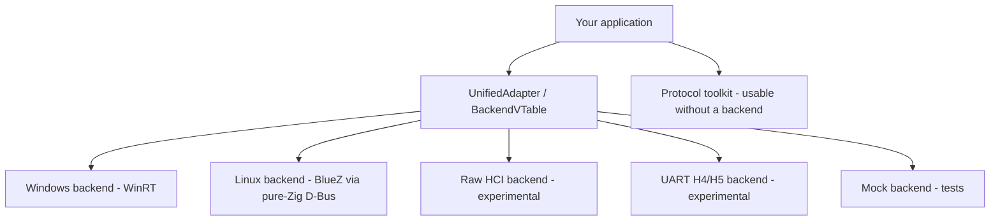

# Zig-BLE v1.3.2

A Bluetooth Low Energy (BLE) library written entirely in Zig (0.17.0+). It works through the native Bluetooth stacks of **Windows 11 (WinRT)** and **Linux (BlueZ)** and ships with a platform-independent toolkit of BLE protocol parsers and encoders, cryptographic functions and SIG profiles.

[](https://github.com/AritoUser/Zig-BLE/actions/workflows/ci.yml)
[](https://github.com/AritoUser/Zig-BLE/releases)
[](LICENSE)

---

## Why Zig-BLE

- **Zig-native, no C dependencies.** On Linux, Zig-BLE talks to BlueZ through its own D-Bus wire client. No `libdbus`, no `libc`, no C toolchain. On Windows it calls the WinRT Bluetooth APIs directly.
- **One binary, easy deployment.** Build a single executable and cross-compile from any machine, for example `zig build -Dtarget=aarch64-linux` for a Raspberry Pi or an industrial gateway. There is no Python environment, shared library or runtime to install on the target.
- **Predictable memory.** No garbage collector. The protocol parsers take no allocator, and the backends use fixed-size pools for devices, characteristics and subscriptions. Behaviour stays the same after days of uptime and on small machines.
- **Proven OS stacks underneath.** Connections, encryption and pairing are handled by WinRT and BlueZ, the same layers used by `btleplug`, `SimpleBLE` and `bleak`. Zig-BLE has been used to scan, connect to and read real devices over the air (see [Real Hardware Live Verification](#real-hardware-live-verification-over-the-air)).
- **A reusable protocol toolkit.** The parsers and encoders for advertising data, ATT/GATT, SMP, HCI, H4 and L2CAP, the Bluetooth crypto functions, the SIG profiles and the Wireshark PCAP writer work without any backend. Use them in tools, tests, sniffers or your own stack.
- **A path to embedded.** The host-stack building blocks (H4 framing, ACL reassembly, ATT/SMP codecs) are written for use without an operating system. A complete bare-metal stack is still in progress (see the status table below).

**About performance:** the parsers are fast (a full advertising packet parses in about 5.5 ns, see [Microbenchmarks](#microbenchmarks)), but in a real BLE application the radio and the operating system set the pace, not the CPU. Zig-BLE is not meant to be faster over the air than other libraries; its advantages are dependencies, deployment and predictable resource use.

---

## Platform Status

| Feature | Windows 11 (WinRT) | Linux (BlueZ) | Linux Raw HCI (`HciBackend`) | Bare-Metal (`UartBackend` H4 / H5) | macOS |
| :--- | :---: | :---: | :---: | :---: | :---: |
| Scanning / advertising reports | ✅ | ✅ | ✅ | 🚧 | ❌ |
| Connect, service discovery | ✅ | ✅ | 🚧 | 🚧 | ❌ |
| GATT read / write / notifications | ✅ | ✅ | 🚧 | 🚧 | ❌ |
| Pairing and bonding | 🧪 (`DeviceInformationCustomPairing`) | ✅ (via BlueZ + pairing agent) | 🚧 | 🚧 | ❌ |
| Negotiated MTU query | 🧪 (`GattSession.MaxPduSize`) | 🧪 (`GattCharacteristic1.MTU`) | 🚧 | 🚧 | ❌ |
| Peripheral: GATT server, advertising | 🧪 (`GattServiceProvider` / `Publisher`) | ✅ (BlueZ GATT + Adv) | ❌ | ❌ | ❌ |

✅ implemented and verified on hardware · 🧪 implemented, not yet verified on hardware · 🚧 experimental, not usable on real hardware yet · ❌ not available

**Raw HCI and UART (`HciBackend`, `UartBackend`) are experimental.** They implement the backend interface and drive the ATT and SMP state machines in tests, but against a real controller they do not work yet: connections do not wait for the controller's connection-complete event, GATT calls return without waiting for the response, and pairing neither asks the user to confirm numeric comparison nor starts link encryption. Use the Windows or BlueZ backend for real devices.

The in-memory **mock backend** (`src/backend/mock/`) implements the full backend interface for tests without hardware. On macOS, the protocol toolkit, crypto functions and parsers build and run, while `MacosBackend` returns `BleError.NotSupported`.

Open items and their status are tracked in [docs/PRODUCTION_READINESS.md](docs/PRODUCTION_READINESS.md).

---

## What's Inside



**Backends** (`src/backend/`)
- `BackendVTable` / `UnifiedAdapter`: one unified, typed-error (`BleError`) API for scanning, connecting, GATT, pairing, timeouts and PCAP capture, independent of the platform.
- Windows (`src/backend/windows/`): WinRT `Windows.Devices.Bluetooth`, configurable static pools (`WindowsBackendWithConfig`), real MTU query (`IGattSession.get_MaxPduSize`), custom pairing (`IDeviceInformationCustomPairing`), disconnect detection (`ConnectionStatusChanged`) and peripheral support (`GattServiceProvider` + `BluetoothLEAdvertisementPublisher`).
- Linux (`src/backend/bluez/`, `src/dbus/wire/`): BlueZ over a pure-Zig D-Bus wire client with real MTU query, `Disconnected` & `bluetoothd` `NameOwnerChanged` recovery; optional `-Dlink-dbus` to use the system `libdbus-1` instead.
- Linux pairing agent (`src/agent.zig`): hardened `org.bluez.Agent1` with strict input validation, callbacks for passkey, PIN and authorization; unhandled requests are always rejected (`org.bluez.Error.Rejected`).
- Peripheral (`src/peripheral.zig`, `src/gatt_server.zig`, `src/advertising.zig`): GATT server (with `encrypt_read/write`, `encrypt_authenticated_*`, `secure_*`, `authorize` flags) and advertising through BlueZ on Linux and WinRT on Windows.
- Raw HCI & UART (`src/backend/hci.zig`, `src/backend/uart.zig`), **experimental**: `HciBackend` and `UartBackend` (H4 & 3-Wire H5 SLIP) drive the built-in `AttBearer` and `SmpStateMachine` over ACL and L2CAP. Not usable with a real controller yet (see Platform Status).

**Protocol toolkit** (platform-independent)
- Advertising data parser and builder (`src/core/advertising.zig`).
- ATT/GATT PDU encoding and decoding, `AttBearer` client & server state machine over L2CAP CID `0x0004` with a 30-second transaction timeout check, `ServiceDiscoveryClient`, long reads (`LongReadClient`) and queued writes (`QueuedWriteClient`) (`src/core/att.zig`).
- SMP PDU encoding/decoding and an experimental `SmpStateMachine` (Legacy & LE Secure Connections Just Works with ECDH P-256; no user confirmation for numeric comparison, no SC passkey entry, no key distribution yet) over L2CAP CID `0x0006`, plus the Bluetooth crypto toolbox verified against Core Spec Vol 3, Part H, Appendix D test vectors: AES-128, AES-CMAC, `ah`, `c1`, `s1`, `f4`, `f5`, `f6`, `g2`, `h6`, `h7` (`src/crypto/`).
- HCI command and event encoding (LE Create/Extended Create Connection, Disconnect, Connection Update, Data Length, Encryption, LE Connection Subrating), ACL flow controller (`AclFlowController`), H4 and 3-Wire H5 UART framing, L2CAP ACL reassembly and signaling (`src/hci/`, `src/l2cap/`).
- EATT bearer & multiplexer (`src/core/eatt.zig`) over L2CAP Credit-Based Flow Control (`local_credits`, `remote_credits`, MPS K-frame SDU segmentation and reassembly, per-bearer fault isolation).
- Authenticated bond store (`src/storage/bond_store.zig`): AES-128-CTR encryption for LTK, IRK and CSRK with an application-supplied key (`initWithKey`, or `initWithKeyFile` for a random `0600` key file; Linux file persistence refuses to run without one, the built-in default key is only used for in-memory images and inside the DPAPI blob), import of v1.2.x files via `deserializeLegacy`, constant-time `CmacAes128` integrity tag, Windows DPAPI (`CryptProtectData`), Linux `0600` permission enforcement, and atomic write-temp-fsync-rename persistence.
- SIG profiles: Heart Rate, Battery, Device Information, Current Time, Health Thermometer, Blood Pressure, HID over GATT, Environmental Sensing, Pulse Oximeter, Fitness Machine, Cycling Power, Running Speed & Cadence, Nordic UART, iBeacon and Eddystone (`src/profiles/`).
- Wireshark PCAP writer (`DLT_BLUETOOTH_HCI_H4`) (`src/tooling/pcap.zig`) with live `PcapHook` integration across backends.

**Testing:** unit, end-to-end and edge-case/stress tests against the mock backend (`zig build test`), a mock end-to-end smoke test (`zig build run-mock-e2e`), coverage-guided fuzz targets (`src/fuzz.zig`) as well as standalone fuzz runners (`zig build fuzz`, `zig build fuzz-dbus`), CI on Linux, Windows and macOS. There is no hardware-in-the-loop testing yet.

---

## Documentation

- [Technical White Paper](docs/WHITEPAPER.md): design of the D-Bus wire client and the protocol engine.
- [Architecture & Protocol Manual](docs/ARCHITECTURE_AND_PROTOCOL_MANUAL.md): memory layout, state machines and packet formats.
- [Roadmap & Extensions](docs/BLE_ROADMAP_AND_EXTENSIONS.md): planned features.
- [Production Readiness Checklist](docs/PRODUCTION_READINESS.md): known gaps and priorities.
- [Changelog](CHANGELOG.md) · [Contributing](CONTRIBUTING.md)
- API reference: `zig build docs` generates HTML documentation in `zig-out/docs/`.

---

## Real Hardware Live Verification (Over-The-Air)

Zig-BLE v1.0.0 has been physically verified over the 2.4 GHz air interface using a physical PC Bluetooth controller communicating with an active smartphone:

```
================================================================================
          ZIG-BLE v1.0.0: LIVE OVER-THE-AIR TELEMETRY & GATT STATISTICS         
================================================================================
Local Controller:            PC Bluetooth adapter (Windows 11)
Target Device:               Samsung Galaxy S25 Ultra
Connection Status:           Connected (Active 2.4 GHz Physical Radio Link)
--------------------------------------------------------------------------------
GATT Services Discovered:    8 (SIG Standard: 6, Vendor 128-Bit: 2)
GATT Characteristics:        38 Total
  * Readable:                31
  * Writable (Req + Cmd):    9
  * Notifiable (CCCD):       22
  * Indicatable (CCCD):      2
--------------------------------------------------------------------------------
Over-the-Air Read Ops:       31 Executed (30 Successful = 96.8%, 1 ProtocolError)
Nutzdaten Received:          78 Bytes Payload
Air Interface Latency:       Min = 37.59 ms | Avg = 57.10 ms | Max = 73.17 ms
Total Interrogation Time:    3236.92 ms (~3.2 seconds for full device profile)
================================================================================
```

**Real Live Payload Sample Extracted Over-the-Air:**
* **GAP Device Name (0x2A00):** `"S25 Ultra "` (20 bytes UTF-8)
* **Telephony Bearer Provider (0x2BB4):** `"E.164"` (ITU-T standard)
* **Telephony Bearer Technology (0x2BB5):** `0x06` (5G NR / LTE active radio)
* **GATT Database Hash (0x2B2A):** `95 79 53 91 F5 F0 94 08 41 E4 DB D4 7D F6 D8 C3` (16 bytes)

---

## Installation

Add `zig_ble` to your `build.zig.zon`:

```sh
zig fetch --save git+https://github.com/AritoUser/Zig-BLE.git
```

Or reference locally in `build.zig.zon`:

```zig
.{
    .name = .my_app,
    .version = "1.0.0",
    .dependencies = .{
        .zig_ble = .{
            .path = "path/to/Zig-BLE",
        },
    },
}
```

In your `build.zig`:

```zig
const zig_ble = b.dependency("zig_ble", .{
    .target = target,
    .optimize = optimize,
});

exe.root_module.addImport("Zig_BLE", zig_ble.module("Zig_BLE"));
```

---

## Quickstart

### 1. Cross-Platform Unified Scanner (Windows & Linux)

```zig
const std = @import("std");
const ble = @import("Zig_BLE");

pub fn main() !void {
    // 1. Initialize native platform backend
    var backend_impl = ble.backend.windows.WindowsBackend.init(); // On Linux: use Linux backend
    defer backend_impl.deinit();

    // 2. Wrap in UnifiedAdapter
    var adapter = ble.UnifiedAdapter.init(backend_impl.asBackend());
    try adapter.setPowered(true);

    const Scanner = struct {
        fn onDevice(dev: *const ble.backend.DiscoveredDevice, _: ?*anyopaque) void {
            const addr = dev.address.toString();
            std.debug.print("Discovered: {s} | \"{s}\"\n", .{
                &addr, dev.getName() orelse "<Unknown>",
            });
        }
    };

    std.debug.print("Scanning for BLE devices...\n", .{});
    try adapter.startScan(.{}, Scanner.onDevice, null);
}
```

### 2. Linux D-Bus Central Scanner (no libdbus, no libc)

```zig
const std = @import("std");
const Zig_BLE = @import("Zig_BLE");

pub fn main() !void {
    var conn = try Zig_BLE.Connection.initSystem();
    defer conn.deinit();

    var adapter = (try Zig_BLE.Adapter.findDefault(&conn)) orelse return error.NoAdapter;
    try adapter.setPowered(true);

    try conn.addMatch("type='signal',interface='org.freedesktop.DBus.ObjectManager',member='InterfacesAdded'");
    try adapter.startDiscovery();
    defer adapter.stopDiscovery() catch {};

    std.debug.print("Listening for BLE advertising signals...\n", .{});
    while (true) {
        _ = conn.pollSocket(200); // Kernel poll sleep (0% CPU)
        while (conn.popMessage()) |msg| {
            defer msg.deinit();
            if (msg.getMessageType() == 4) { // Signal
                // Process zero-copy discovery events...
            }
        }
    }
}
```

### 3. Wireshark PCAP Protocol Capture Generator

```zig
const std = @import("std");
const ble = @import("Zig_BLE");

pub fn main() !void {
    var file = try std.fs.cwd().createFile("capture.pcap", .{});
    defer file.close();

    var pcap_writer = ble.pcap.PcapWriter(@TypeOf(file)).init(file);
    try pcap_writer.writeHeader(); // Standard PCAP magic (DLT_BLUETOOTH_HCI_H4)

    // Capture an ATT Exchange MTU PDU
    try pcap_writer.writeAttPdu(0x0040, 0x0004, &[_]u8{ 0x02, 0xF7, 0x00 });
}
```

---

## Architekturvergleich

Qualitativer Vergleich der Bauweise, keine Performance-Messung. Für die anderen Bibliotheken wurden keine Benchmarks mit denselben Daten durchgeführt, deshalb enthält diese Tabelle bewusst keine Durchsatzzahlen.

| Kriterium | **Zig-BLE v1.3.2** | **Rust (`btleplug`)** | **C++ (`SimpleBLE`)** | **Embedded C (`NimBLE`)** | **Python (`bleak`)** |
| :--- | :--- | :--- | :--- | :--- | :--- |
| **Sprache** | Zig 0.17+ | Rust | C++17 | C99 | Python 3.8+ |
| **`libc` nötig (Linux)** | Nein (eigener D-Bus-Wire-Client) | Ja (indirekt) | Ja | Teilweise | Ja (Python-Runtime) |
| **Heap-freie Parser** | Ja (Parser nehmen keinen Allocator) | Nein | Nein | Ja (statische Pools) | Nein |
| **`bluetoothd` nötig (Linux)** | Für Verbindungen ja; Scannen per Raw-HCI auch ohne | Ja | Ja | Nein (eigener Host-Stack) | Ja |
| **Bare-Metal / MCU** | Experimentell (`UartBackend` H4/H5, noch nicht mit echtem Controller nutzbar) | Nein | Nein | Ja (ESP32/nRF) | Nein |
| **Pairing unter Windows** | Ja (`DeviceInformationCustomPairing`) | Ja (über das OS) | Ja (über das OS) | – | Ja (über das OS) |

---

## Microbenchmarks

`zig build run-bench` (`ReleaseFast`, ein Thread). Gemessen auf einem AMD Ryzen 9 9950X3D unter Windows 11, drei Läufe; angegeben ist der Median und die Spanne der drei Läufe in Nanosekunden pro Operation.

| Operation | Median | Spanne (3 Läufe) |
| :--- | ---: | ---: |
| `AdvertisingReport.parse` (komplettes Paket, 31 Byte) | 5,5 ns | 5,4 – 5,6 ns |
| `AdIterator.next` (TLV-Walk, 4 Elemente) | 19,7 ns | 19,6 – 21,1 ns |
| `UUID.parse` (128 Bit, mit Bindestrichen) | 11,4 ns | 11,3 – 11,5 ns |
| `UUID.parse` (128 Bit, 32 Zeichen ohne Bindestriche) | 11,0 ns | 11,0 – 11,2 ns |
| `AdStructure.asServiceData16` | 0,50 ns | 0,48 – 0,53 ns |
| `UUID.toString` (128 Bit) | 1,2 ns | 1,2 – 1,2 ns |
| `Address.parse` + `classifyRandom` | 0,75 ns | 0,71 – 0,80 ns |
| `Cccd.encode` + `Cccd.decode` | 0,58 ns | 0,58 – 0,59 ns |
| Assigned-Numbers-Lookup (Service-Name) | 0,85 ns | 0,81 – 0,87 ns |
| D-Bus `Message.finalize` | 2,6 ns | 2,5 – 2,9 ns |
| D-Bus `MessageIter` | 2,0 ns | 1,9 – 2,1 ns |
| `H4StreamParser.feed` (UART-Frame) | 5,1 ns | 5,1 – 6,0 ns |
| `AclReassembler.processFragment` | 0,88 ns | 0,86 – 0,90 ns |
| GATT Long Write (60 Byte zerlegen + Server-Queue zusammensetzen) | 8,1 ns | 8,0 – 8,6 ns |
| `BondStore.deserialize` (NVS-Image mit AES-128-CTR + AES-CMAC) | 100,5 ns | 99,5 – 101,8 ns |

**Einordnung:**

- Werte unter ~1 ns entsprechen wenigen CPU-Takten. Sie zeigen, dass die Operation praktisch nichts kostet, eignen sich aber nicht für Vergleiche untereinander; dort dominieren Messrauschen und Compiler-Optimierung.
- Bei echtem BLE-Betrieb begrenzt der Funk, nicht die CPU: Ein Verbindungsintervall dauert mindestens 7,5 ms, ein Scanner in voller Umgebung sieht einige tausend Advertising-Pakete pro Sekunde. Bei ~5,5 ns pro Paket entspricht das weit unter 0,01 % eines CPU-Kerns.
- Die Werte hängen stark von CPU, Betriebssystem und Taktverhalten ab. Für eigene Zahlen `zig build run-bench` mehrmals ausführen.

---

## Test- & Build-Befehle

```sh
# Führt alle Unit-, E2E-Pipeline- und Edge-Case-Tests aus
zig build test

# Führt die offizielle Live-Hardware-Verifikation durch
zig build run-v1-live

# Startet den nativen Windows-Hardware-Scanner
zig build run-windows-scanner

# Führt die Microbenchmark-Suite aus
zig build run-bench

# Führt Fuzz-Tests gegen manipulierte Werbepakete aus (500k Iterationen)
zig build fuzz

# Führt D-Bus Wire Protocol Fuzzing aus (200k Iterationen)
zig build fuzz-dbus

# Generiert die interaktive HTML-Dokumentation
zig build docs

# Cross-Kompilierung für Linux ohne C-Compiler
zig build -Dtarget=x86_64-linux

# Optional: Linkt system libdbus-1 (Legacy C-Fallback; Standard ist Pure-Zig Wire)
zig build -Dlink-dbus=true
```

---

## License

This project is licensed under the [MIT License](LICENSE).
