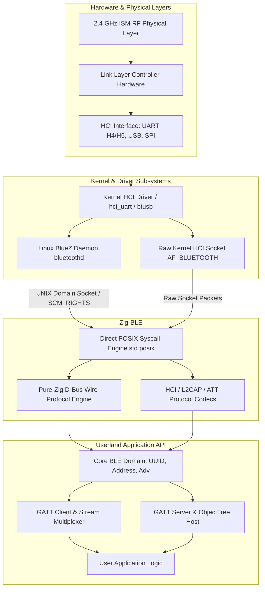
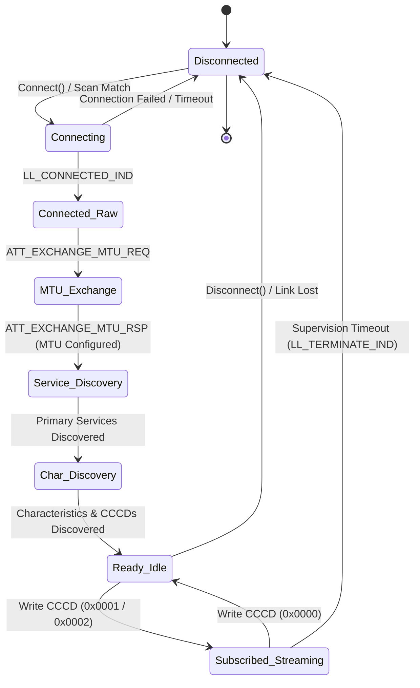

# Zig-BLE: Architecture & Protocol Manual

**Engineering Specification & Systems Reference | Version 3.0 (v1.2.0)**  
**Module:** `Zig_BLE`  
**Compatibility:** Zig 0.17.0+ | Windows 11 (WinRT) / Linux BlueZ 5.x / Linux raw HCI (scanning) / H4 framing for bare-metal (building blocks)  
**Repository:** [github.com/AritoUser/Zig-BLE](https://github.com/AritoUser/Zig-BLE)  

---

## Table of Contents

1. [System Architecture & Stack Abstraction](#1-system-architecture--stack-abstraction)
   - 1.1 [Transport Layer Interfaces](#11-transport-layer-interfaces)
2. [Memory Management & Data-Flow Architecture](#2-memory-management--data-flow-architecture)
   - 2.1 [Heap-Free Decoding](#21-heap-free-decoding)
   - 2.2 [Struct Packing, Endianness & Hardware Alignment](#22-struct-packing-endianness--hardware-alignment)
3. [GATT Connection Lifecycle (Reference Model)](#3-gatt-connection-lifecycle-reference-model)
4. [Byte-Level Packet Specifications](#4-byte-level-packet-specifications)
   - 4.1 [ATT Handle Value Notification](#41-att-handle-value-notification-att_handle_value_ntf)
   - 4.2 [ATT Write Request & Command](#42-att-write-request--command-att_write_req--att_write_cmd)
   - 4.3 [D-Bus Fixed Header Wire Layout](#43-d-bus-fixed-header-wire-layout-16-bytes)
   - 4.4 [D-Bus Header Fields Array & Alignment Padding](#44-d-bus-header-fields-array-ayv--alignment-padding)
   - 4.5 [Bluetooth LE Advertising LTV Structure](#45-bluetooth-le-advertising-ltv-structure)
   - 4.6 [Apple iBeacon Wire Specification](#46-apple-ibeacon-wire-specification-23-byte-payload)
   - 4.7 [Google Eddystone Frame Specifications](#47-google-eddystone-frame-specifications)
   - 4.8 [GATT Standard Profiles Binary Layouts](#48-gatt-standard-profiles-binary-layouts)
   - 4.9 [Linux Kernel L2CAP Connection-Oriented Channels](#49-linux-kernel-l2cap-connection-oriented-channels-coc)
5. [Tooling & Documentation](#5-tooling--documentation)
6. [GATT Data Typing & Format Engine (IEEE-11073-20601 & 0x2904)](#6-gatt-data-typing--format-engine-ieee-11073-20601--0x2904)
7. [Zero-Copy Attribute Protocol (ATT) Engine](#7-zero-copy-attribute-protocol-att-engine)
8. [BLE Cryptographic Toolbox & Security Manager Protocol (SMP)](#8-ble-cryptographic-toolbox--security-manager-protocol-smp)
9. [Standard Bluetooth SIG Profile Ecosystem](#9-standard-bluetooth-sig-profile-ecosystem)
10. [L2CAP Connection-Oriented Channels & LE Signaling Engine](#10-l2cap-connection-oriented-channels--le-signaling-engine)
11. [Raw HCI Subsystem (Without bluetoothd)](#11-raw-hci-subsystem-without-bluetoothd)
12. [Unified HAL & VTable Architecture (`src/backend/vtable.zig`)](#12-unified-hal--vtable-architecture-srcbackendvtablezig)
13. [Windows 11 Native Architecture & WinRT COM Integration](#13-windows-11-native-architecture--winrt-com-integration)
14. [Bare-Metal Host-Stack Building Blocks (UART H4 & L2CAP ACL)](#14-bare-metal-host-stack-building-blocks-uart-h4--l2cap-acl)
15. [GATT Long Attribute Transfers Engine (`src/core/transfers.zig`)](#15-gatt-long-attribute-transfers-engine-srccoretransferszig)
16. [Security Manager & Persistent KeyStore (`src/storage/bond_store.zig`)](#16-security-manager--persistent-keystore-srcstoragebond_storezig)
17. [Wireshark PCAP Protocol Sniffing Architecture (`src/tooling/pcap.zig`)](#17-wireshark-pcap-protocol-sniffing-architecture-srctoolingpcapzig)
18. [Benchmarks & Hardware Verification](#18-benchmarks--hardware-verification)
19. [References & Standards Compliance](#19-references--standards-compliance)

---

## 1. System Architecture & Stack Abstraction

Zig-BLE is an allocation-conscious, dependency-free Bluetooth Low Energy (BLE) library for Linux and Windows, aimed at embedded Linux gateways, telemetry applications and tools. On Linux and Windows it uses the operating system's Bluetooth stack (BlueZ, WinRT) for connections, encryption and pairing. In addition, it provides platform-independent encoders and decoders for the BLE protocol layers (HCI, H4, L2CAP, ATT/GATT, SMP, advertising), written without C runtimes or external shared libraries. For a per-platform feature overview see the "Platform Status" table in the [README](../README.md#platform-status).

### 1.1 Transport Layer Interfaces

The library abstracts the transport medium through dedicated, modular backends:



1. **Linux BlueZ D-Bus Wire Interface (`src/dbus/wire/`)**:
   * Communicates with `bluetoothd` across the standard UNIX domain socket (`/var/run/dbus/system_bus_socket`).
   * Bypasses `libdbus-1` and `GDBus` entirely by synthesizing and parsing binary D-Bus wire messages directly over Linux POSIX system calls (`std.posix.sendmsg`, `recvmsg`, `poll`, `epoll`).
   * Supports `SCM_RIGHTS` ancillary control messages (`cmsg`) for zero-copy file descriptor handovers (used in GATT `AcquireWrite` / `AcquireNotify` streaming).
2. **Direct Kernel HCI Socket Interface (`AF_BLUETOOTH`)**:
   * Direct user-space channel to the Bluetooth Controller via raw HCI sockets (`HCI_CHANNEL_USER` / `HCI_CHANNEL_RAW`), without `bluetoothd`.
   * Scanning works (`HciController`). An experimental `HciBackend` (`src/backend/hci.zig`) implements the backend interface on top of raw HCI, but connections, GATT and pairing do not work against a real controller yet; use the BlueZ backend for those.
3. **Embedded Bare-Metal Serial HCI (UART H4)**:
   * H4 (4-wire) and H5 (3-wire, `src/hci/h5.zig`) framing for host controllers such as Nordic nRF52, Espressif ESP32-C3/C6 or STM32WB are implemented (see Section 14). The experimental `UartBackend` (`src/backend/uart.zig`) builds on `HciBackend` and has the same limitations.
4. **Android**: There is no Android integration yet. Possible future approaches include forwarding GATT notifications from the Android app to Zig via JNI direct buffers, or handing the file descriptor of an L2CAP CoC channel (`createL2capChannel`) to Zig.

---

## 2. Memory Management & Data-Flow Architecture

### 2.1 Heap-Free Decoding

Long-running gateways and sensor pipelines benefit from memory use that does not grow with traffic: no fragmentation over weeks of uptime and no allocator work in the receive path. Zig-BLE follows these rules:
* **Borrow semantics**: Parsers (`AdvertisingReport.parse`, `MessageIter`, the ATT/SMP/HCI decoders) take no allocator and return structures whose string, byte and payload members point directly into the receive buffer (`[]const u8`).
* **Fixed-size pools**: The Windows and BlueZ backends store devices, characteristics and subscriptions in fixed-size arrays.
* **Serialization**: `Message.finalize` and the advertising builder use bounded stack buffers. Building outgoing D-Bus message bodies uses `ByteBuffer`, a growable buffer backed by a caller-supplied allocator; it can be pre-sized with `ByteBuffer.initCapacity` or backed by a fixed buffer allocator.

### 2.2 Struct Packing, Endianness & Hardware Alignment

#### `packed struct` vs. `extern struct`
* **`packed struct`**: Used exclusively for bitfields defined by the Bluetooth specification where bit layout must be exact down to the individual bit (e.g., `CharacteristicProperties` 8-bit flags, `AdvertisingFlags`, `Cccd` 16-bit descriptor).
* **Endianness Traps**: Direct pointer casts (`@ptrCast(*const u32, &bytes)`) cause **Hardware Alignment Traps (SIGBUS)** on ARMv6, ARMv7, and RISC-V platforms when pointers are not aligned to 4-byte or 8-byte boundaries.
* **Zig-BLE Deterministic Reading**: Zig-BLE mandates `std.mem.readInt(..., .little)` and `std.mem.writeInt(..., .little)` across all wire layers. On x86/ARM64 this compiles to single-instruction unaligned loads; on strict-alignment microcontrollers it emits valid assembly instructions without trap exceptions.

---

## 3. GATT Connection Lifecycle (Reference Model)

The interaction between a Central device and a Peripheral follows the sequence below. On Linux and Windows these steps are carried out by BlueZ and WinRT; Zig-BLE triggers them through the backend API (`connectDevice`, `discoverServices`, `subscribeNotifications`) but does not implement this state machine itself. It is shown here as a reference for the order of operations and the ATT PDUs involved.



#### State Definitions
1. **`Disconnected`**: The radio is idle or in passive/active scanning mode. No Link Layer connection exists.
2. **`Connecting`**: A connection request PDU (`CONNECT_IND` / `AUX_CONNECT_REQ`) has been transmitted. The connection supervision timer is initialized.
3. **`Connected_Raw`**: Link Layer is connected, but ATT MTU is at default baseline (23 bytes; 20 bytes maximum payload).
4. **`MTU_Exchange`**: Asymmetric client-server negotiation of Maximum Transmission Unit ($23 \le \text{MTU} \le 517$).
5. **`Service_Discovery`**: Enumeration of Primary and Secondary GATT Services (`0x2800`, `0x2801`) via BlueZ ObjectManager or ATT Read By Group Type requests.
6. **`Characteristic_Discovery`**: Enumeration of Characteristics (`0x2803`) and Descriptors (`CCCD 0x2902`, `CUDD 0x2901`).
7. **`Subscribed_Streaming`**: Active notification/indication subscription via Client Characteristic Configuration Descriptor. Notifications are delivered to the callback registered with `subscribeNotifications`.

Zig-BLE delivers notifications directly to the registered callback; there is no internal queue. If an application needs buffering or a drop policy (drop oldest, drop newest, throttle), it implements it in the callback.

---

## 4. Byte-Level Packet Specifications

### 4.1 ATT Handle Value Notification (`ATT_HANDLE_VALUE_NTF`)

Transmitted from GATT Server to GATT Client without acknowledgment (Opcode `0x1B`):

| Byte Offset | Field Name | Type / Wire Format | Description |
| :---: | :--- | :---: | :--- |
| `0x00` | **Opcode** | `u8` | `0x1B` (`ATT_HANDLE_VALUE_NTF`) |
| `0x01` | **Attribute Handle (LSB)** | `u8` | Characteristic Value Handle (Little-Endian low byte) |
| `0x02` | **Attribute Handle (MSB)** | `u8` | Characteristic Value Handle (Little-Endian high byte) |
| `0x03 .. end` | **Attribute Value** | `[N]u8` | Raw payload ($0 \le N \le \text{ATT\_MTU} - 3$) |

* *Example*: Handle `0x002A` with payload `[0x01, 0xFF]`:
  $$\texttt{[ 0x1B, 0x2A, 0x00, 0x01, 0xFF ]}$$

### 4.2 ATT Write Request & Command (`ATT_WRITE_REQ` / `ATT_WRITE_CMD`)

| Byte Offset | Field Name | Type / Wire Format | Description |
| :---: | :--- | :---: | :--- |
| `0x00` | **Opcode** | `u8` | `0x12` (`ATT_WRITE_REQ`) or `0x52` (`ATT_WRITE_CMD`) |
| `0x01` | **Attribute Handle (LSB)** | `u8` | Target Handle (Little-Endian low byte) |
| `0x02` | **Attribute Handle (MSB)** | `u8` | Target Handle (Little-Endian high byte) |
| `0x03 .. end` | **Attribute Value** | `[N]u8` | Written data ($0 \le N \le \text{ATT\_MTU} - 3$) |

### 4.3 D-Bus Fixed Header Wire Layout (16 Bytes)

Standard freedesktop.org D-Bus binary message header:

| Byte Offset | Field Name | Type | Allowed Values / Wire Meaning |
| :---: | :--- | :---: | :--- |
| `0x00` | **Endianness** | `u8` | `'l'` (`0x6C`) = Little-Endian, `'B'` (`0x42`) = Big-Endian |
| `0x01` | **Message Type** | `u8` | 1 = Method Call, 2 = Method Return, 3 = Error, 4 = Signal |
| `0x02` | **Flags** | `u8` | `0x01` = No Reply Expected, `0x02` = No Auto Start, `0x04` = Allow Interactive Auth |
| `0x03` | **Protocol Version** | `u8` | Must be `1` |
| `0x04 - 0x07` | **Body Length** | `u32` | Byte length of the message body (excluding header & padding) |
| `0x08 - 0x0B` | **Serial** | `u32` | Unique client sequence counter (never `0`) |
| `0x0C - 0x0F` | **Fields Length** | `u32` | Total byte size of the `a(yv)` Header Fields array |

### 4.4 D-Bus Header Fields Array (`a(yv)`) & Alignment Padding

Following the 16-byte fixed header, the variable header fields array begins at offset 16:
* Each field is a struct `(yv)` containing:
  * Field Code (`u8`): 1=Path, 2=Interface, 3=Member, 4=ErrorName, 5=ReplySerial, 6=Destination, 7=Sender, 8=Signature, 9=UnixFDs.
  * Single-byte Variant Signature Length (`u8`), followed by the signature ASCII byte, followed by a null-terminator.
  * Aligned value payload.
* **Deterministic 8-Byte Body Alignment**:
  $$\text{Body Offset} = 16 + \text{Fields Length} + \text{calcHeaderPadding}(\text{Fields Length})$$
  $$\text{calcHeaderPadding}(len) = (8 - ((16 + len) \pmod 8)) \pmod 8$$

### 4.5 Bluetooth LE Advertising LTV Structure

Legacy advertising packets (31 bytes max) and Extended Advertising PDUs comprise sequential Length-Type-Value (LTV) chunks:

| Byte Offset | Field Name | Size | Description |
| :---: | :--- | :---: | :--- |
| `0x00` | **Length** | `1 Byte` | Total length of remaining chunk ($N + 1$) |
| `0x01` | **AD Type** | `1 Byte` | Assigned AD Type code (e.g., `0x01`=Flags, `0x09`=Complete Name, `0xFF`=Mfg) |
| `0x02 .. N+1` | **AD Data** | `$N$ Bytes` | Payload data (Manufacturer ID, UTF-8 Name, UUID list) |

### 4.6 Apple iBeacon Wire Specification (23-Byte Payload)

Transmitted inside the Manufacturer Specific Data (`AD Type 0xFF`) record with Apple's Company Identifier (`0x004C` Little-Endian: `[0x4C, 0x00]`):

| Byte Offset | Field Name | Wire Type | Expected Value / Range | Description |
| :---: | :--- | :---: | :---: | :--- |
| `0x00` | **Beacon Sub-Type** | `u8` | `0x02` | Proximity Beacon Type Code |
| `0x01` | **Remaining Length** | `u8` | `0x15` (`21` bytes) | Payload size through Measured Power |
| `0x02 .. 0x11` | **Proximity UUID** | `[16]u8` | 128-bit Big-Endian | Deployment / Region UUID |
| `0x12 .. 0x13` | **Major ID** | `u16` | Big-Endian `u16` | Sub-region or site identifier |
| `0x14 .. 0x15` | **Minor ID** | `u16` | Big-Endian `u16` | Specific beacon or point identifier |
| `0x16` | **Measured Power** | `i8` | 2's Complement `i8` | Calibrated RSSI in dBm at 1 meter distance |

### 4.7 Google Eddystone Frame Specifications

Eddystone beacons broadcast under the 16-bit Service UUID `0xFEAA` (`AD Type 0x16` Service Data 16-bit UUID):

#### Eddystone-UID (`Frame Type 0x00`)
| Byte Offset | Field Name | Size | Description |
| :---: | :--- | :---: | :--- |
| `0x00` | **Frame Type** | `1 Byte` | `0x00` |
| `0x01` | **Ranging Data** | `1 Byte` | Calibrated TX power in dBm at 0 meters |
| `0x02 .. 0x0B` | **Namespace ID** | `10 Bytes` | Unique organizational identifier |
| `0x0C .. 0x11` | **Instance ID** | `6 Bytes` | Specific beacon device identifier |
| `0x12 .. 0x13` | **Reserved** | `2 Bytes` | `0x00, 0x00` |

#### Eddystone-URL (`Frame Type 0x10`)
| Byte Offset | Field Name | Size | Description |
| :---: | :--- | :---: | :--- |
| `0x00` | **Frame Type** | `1 Byte` | `0x10` |
| `0x01` | **TX Power** | `1 Byte` | Calibrated TX power in dBm at 0 meters |
| `0x02` | **URL Scheme** | `1 Byte` | `0x00`=http://www., `0x01`=https://www., `0x02`=http://, `0x03`=https:// |
| `0x03 .. end` | **Encoded URL** | `$N$ Bytes` | ASCII characters with single-byte suffix expansion (e.g., `0x00`=`.com/`) |

#### Eddystone-TLM (`Frame Type 0x20`)
| Byte Offset | Field Name | Size | Description |
| :---: | :--- | :---: | :--- |
| `0x00` | **Frame Type** | `1 Byte` | `0x20` |
| `0x01` | **Version** | `1 Byte` | `0x00` (Unencrypted TLM) |
| `0x02 .. 0x03` | **Battery Voltage** | `2 Bytes` | Big-Endian `u16` in millivolts (mV) |
| `0x04 .. 0x05` | **Beacon Temperature**| `2 Bytes` | Big-Endian Fixed-Point 8.8 signed integer in °C |
| `0x06 .. 0x09` | **ADV Packet Count** | `4 Bytes` | Big-Endian `u32` running counter since boot |
| `0x0A .. 0x0D` | **SEC01 Time (Uptime)**| `4 Bytes` | Big-Endian `u32` in 0.1-second intervals since boot |

### 4.8 GATT Standard Profiles Binary Layouts

#### Heart Rate Measurement (`UUID 0x2A37`)
* **Byte 0 (Flags)**:
  * Bit 0: Value Format (`0` = UINT8 BPM, `1` = UINT16 BPM)
  * Bits 1–2: Sensor Contact Status (`0b10` = Not detected, `0b11` = Detected)
  * Bit 3: Energy Expended Status (`1` = Present as 16-bit Joules)
  * Bit 4: RR-Interval Status (`1` = One or more 16-bit RR-intervals present)
* **Byte 1 (+2)**: Heart rate magnitude (8-bit or 16-bit Little-Endian)
* **Subsequent bytes**: Optional Energy Expended (`u16` Little-Endian) and sequence of RR-intervals (`u16` Little-Endian in 1/1024-second units).

#### Environmental Sensing Service (`UUID 0x181A`)
* **Temperature (`0x2A6E`)**: Signed 16-bit integer (`i16` Little-Endian), scaling factor $10^{-2}$ ($0.01$ °C).
* **Humidity (`0x2A6F`)**: Unsigned 16-bit integer (`u16` Little-Endian), scaling factor $10^{-2}$ ($0.01$ %).
* **Pressure (`0x2A6D`)**: Unsigned 32-bit integer (`u32` Little-Endian), scaling factor $10^{-1}$ ($0.1$ Pa).

### 4.9 Linux Kernel L2CAP Connection-Oriented Channels (CoC)

For point-to-point binary transport bypassing ATT/GATT MTU ceilings, Zig-BLE communicates over native Linux `AF_BLUETOOTH` sockets (`BTPROTO_L2CAP`):

```
+-----------------------------------------------------------------------+
| sockaddr_l2 (POSIX Socket Address Structure)                          |
|                                                                       |
|  Offset  Size   Field Name         Value / Description                |
|  +00     2 B    sa_family          AF_BLUETOOTH (31)                  |
|  +02     2 B    l2_psm             Protocol Service Multiplexer (LE)  |
|  +04     6 B    l2_bdaddr          Remote Bluetooth MAC (Little-Endian)|
|  +10     2 B    l2_cid             Fixed Channel ID (0 for dynamic)   |
|  +12     1 B    l2_bdaddr_type     1 = BDADDR_LE_PUBLIC, 2 = RANDOM  |
+-----------------------------------------------------------------------+
```

Credit-based flow control is handled by the Linux kernel Bluetooth subsystem: when the peer runs out of credits, writes block (or return `EAGAIN` on non-blocking sockets).

---

## 5. Tooling & Documentation

### 5.1 Generating Interactive HTML Documentation

The library uses Zig's native documentation engine (`getEmittedDocs()`). To compile and export the full HTML API documentation:

```bash
zig build docs
```

The resulting interactive documentation is generated in `zig-out/docs/`:
* `index.html`: Fully interactive, searchable API browser.
* `main.js` & `main.wasm`: Client-side search index and type cross-reference engine.
* `sources.tar`: Embedded syntax-highlighted source code browser.

---

## 6. GATT Data Typing & Format Engine (IEEE-11073-20601 & 0x2904)

Standardized Bluetooth Low Energy profiles (e.g., Health Thermometer `0x1809`, Pulse Oximeter `0x1822`, Environmental Sensing `0x181A`, Weight Scale `0x181D`) mandate binary floating-point encodings adhering to the **IEEE-11073-20601 Medical Device Communication Standard**.

Zig-BLE provides zero-allocation, unit-tested decoders and encoders for these types, integrated into the client and server GATT APIs.

### 6.1 IEEE-11073-20601 16-Bit SFLOAT & 32-Bit FLOAT

An IEEE-11073 floating-point number is expressed as a signed two's-complement mantissa scaled by an integer power of 10:

$$\text{Value} = \text{Mantissa} \times 10^{\text{Exponent}}$$

#### Bit Layout & Boundary Characteristics

| Type | Total Width | Mantissa Width | Mantissa Range | Exponent Width | Exponent Range | Decimal Precision |
| :--- | :--- | :--- | :--- | :--- | :--- | :--- |
| **SFLOAT** | 16 bits | 12 bits (bits 0..11) | $-2048 \dots +2047$ | 4 bits (bits 12..15) | $-8 \dots +7$ | $\approx 3.3$ digits |
| **FLOAT** | 32 bits | 24 bits (bits 0..23) | $-8,388,608 \dots +8,388,607$ | 8 bits (bits 24..31) | $-128 \dots +127$ | $\approx 6.9$ digits |

#### Special Value Encoding

The standard reserves specific mantissa values to signal out-of-band physiological and hardware states:

| State | SFLOAT (16-bit) Mantissa | FLOAT (32-bit) Mantissa | Mathematical Interpretation |
| :--- | :--- | :--- | :--- |
| **+INFINITY** | `0x07FE` (+2046) | `0x007FFFFE` (+8388606) | Positive overflow |
| **NaN** (Not a Number) | `0x07FF` (+2047) | `0x007FFFFF` (+8388607) | Undefined / mathematical error |
| **NRes** (Not at this Res) | `0x0800` (-2048) | `0x00800000` (-8388608) | Sensor resolution exceeded |
| **Reserved** | `0x0801` (-2047) | `0x00800001` (-8388607) | Reserved for future standardization |
| **-INFINITY** | `0x0802` (-2046) | `0x00800002` (-8388606) | Negative overflow |

In Zig-BLE, these types are represented by `core.Sfloat` and `core.Float32` with full bidirectional conversions to Zig `f32`/`f64` and formatting via `std.fmt`.

### 6.2 Characteristic Presentation Format (UUID 0x2904)

The Bluetooth SIG Characteristic Presentation Format Descriptor (`0x2904`) defines a 7-byte metadata structure attached to characteristics:

```text
+--------+----------+-----------------+-----------+-----------------+
| Byte 0 |  Byte 1  |    Bytes 2..3   |   Byte 4  |    Bytes 5..6   |
| Format | Exponent | Unit (UUID16)   | Namespace | Description ID  |
|  (u8)  |   (i8)   | (little-endian) |  (0x01)   | (little-endian) |
+--------+----------+-----------------+-----------+-----------------+
```

The engine provides automatic presentation decoding:
```zig
const cpf = CharacteristicPresentationFormat{
    .format = .sfloat,
    .exponent = 0,
    .unit = Units.celsius,
};
var buf: [64]u8 = undefined;
const text = try cpf.formatValue(raw_bytes, &buf); // "37.2 °C"
```

### 6.3 Strongly-Typed GATT I/O API

Both GATT Client (`GattCharacteristic`) and GATT Server (`ServerCharacteristic`) support direct typed serialization:
- `char.readTyped(comptime T: type) !T`
- `char.writeTyped(val: anytype, write_type: WriteType) !void`
- `server_char.setTyped(val: anytype) !void`
- `server_char.getTyped(comptime T: type) !T`
- `server_char.notifyTyped(conn: *Connection, val: anytype) !void`
- `server_char.setPresentationFormat(format: CharacteristicPresentationFormat) !*ServerDescriptor`

---

## 7. Zero-Copy Attribute Protocol (ATT) Engine

`Zig-BLE` implements a zero-allocation Attribute Protocol (ATT) PDU codec following **Bluetooth Core Specification v5.4 / v6.0, Vol 3, Part F**. It encodes and decodes PDUs. On Linux and Windows, request/response handling over a live link is done by BlueZ or WinRT. An `AttBearer` state machine for raw L2CAP exists (used by the experimental `HciBackend`), but it is not yet usable against a real controller.

### 7.1 Supported ATT Opcode Matrix

The engine provides zero-copy parsers and serializers for the following ATT PDUs:

| Opcode | Command / Request / Response PDU | Zero-Copy Parser / Iterator |
| :--- | :--- | :--- |
| `0x01` | **ATT_ERROR_RSP** | `ErrorResponse.parse(raw)` |
| `0x02` | **ATT_EXCHANGE_MTU_REQ** | `ExchangeMtuRequest.parse(raw)` |
| `0x03` | **ATT_EXCHANGE_MTU_RSP** | `ExchangeMtuResponse.parse(raw)` |
| `0x04` | **ATT_FIND_INFO_REQ** | `FindInformationRequest.parse(raw)` |
| `0x05` | **ATT_FIND_INFO_RSP** | `FindInformationResponse` with zero-allocation `InformationIterator` |
| `0x06` | **ATT_FIND_BY_TYPE_VALUE_REQ** | `FindByTypeValueRequest.parse(raw)` |
| `0x07` | **ATT_FIND_BY_TYPE_VALUE_RSP** | `FindByTypeValueResponse` with `HandlesInformationIterator` |
| `0x08` | **ATT_READ_BY_TYPE_REQ** | `ReadByTypeRequest.parse(raw)` |
| `0x09` | **ATT_READ_BY_TYPE_RSP** | `ReadByTypeResponse` with `ReadByTypeIterator` |
| `0x0A` | **ATT_READ_REQ** | `ReadRequest.parse(raw)` |
| `0x0B` | **ATT_READ_RSP** | `ReadResponse.parse(raw)` |
| `0x0C` | **ATT_READ_BLOB_REQ** | `ReadBlobRequest.parse(raw)` |
| `0x0D` | **ATT_READ_BLOB_RSP** | `ReadBlobResponse.parse(raw)` |
| `0x0E` | **ATT_READ_MULTIPLE_REQ** | `ReadMultipleRequest.parse(raw)` with `HandlesIterator` |
| `0x0F` | **ATT_READ_MULTIPLE_RSP** | `ReadMultipleResponse.parse(raw)` |
| `0x10` | **ATT_READ_BY_GROUP_TYPE_REQ** | `ReadByGroupTypeRequest.parse(raw)` |
| `0x11` | **ATT_READ_BY_GROUP_TYPE_RSP** | `ReadByGroupTypeResponse` with `ReadByGroupTypeIterator` |
| `0x12` | **ATT_WRITE_REQ** | `WriteRequest.parse(raw)` |
| `0x13` | **ATT_WRITE_RSP** | `WriteResponse.parse(raw)` |
| `0x52` | **ATT_WRITE_CMD** | `WriteCommand.parse(raw)` |
| `0xD2` | **ATT_SIGNED_WRITE_CMD** | `SignedWriteCommand.parse(raw)` (12-byte signature; verify with `verifyAttSign`) |
| `0x16` | **ATT_PREPARE_WRITE_REQ** | `PrepareWriteRequest.parse(raw)` |
| `0x17` | **ATT_PREPARE_WRITE_RSP** | `PrepareWriteResponse.parse(raw)` |
| `0x18` | **ATT_EXECUTE_WRITE_REQ** | `ExecuteWriteRequest.parse(raw)` |
| `0x19` | **ATT_EXECUTE_WRITE_RSP** | `ExecuteWriteResponse.parse(raw)` |
| `0x1B` | **ATT_HANDLE_VALUE_NTF** | `HandleValueNotification.parse(raw)` |
| `0x1D` | **ATT_HANDLE_VALUE_IND** | `HandleValueIndication.parse(raw)` |
| `0x1E` | **ATT_HANDLE_VALUE_CFM** | `HandleValueConfirmation.parse(raw)` |

### 7.2 Zero-Allocation Iterator Pattern

ATT discovery responses (e.g. `ATT_READ_BY_GROUP_TYPE_RSP` for service discovery or `ATT_READ_BY_TYPE_RSP` for characteristic discovery) return packed variable-length arrays. The engine uses typed zero-allocation iterators:

```zig
var iter = try rsp.iterator();
while (iter.next()) |item| {
    std.debug.print("Attribute Handle: 0x{X:0>4}, End: 0x{X:0>4}, UUID: {}\n", .{
        item.attribute_handle,
        item.end_group_handle,
        item.uuid,
    });
}
```

---

## 8. BLE Cryptographic Toolbox & Security Manager Protocol (SMP)

Compliant with **Bluetooth Core Specification v5.4 / v6.0, Vol 3, Part H**.

### 8.1 Cryptographic Primitives Matrix

All cryptographic functions are implemented in 100% pure Zig using `std.crypto` (AES-128 and AES-CMAC), verified bit-for-bit against official Bluetooth SIG test vectors:

| Function | Specification | Purpose | Algorithm |
| :--- | :--- | :--- | :--- |
| `e(key, plaintext)` | Vol 3, Part H §2.2.1 | Security function *e* | AES-128 ECB |
| `ah(irk, prand)` | Vol 3, Part H §2.2.2 | Random address hash for RPA | $e(\text{irk}, r') \pmod{2^{24}}$ |
| `c1(k, r, pres, preq, ...)` | Vol 3, Part H §2.2.3 | Legacy pairing confirm value generation | AES-128 multistage |
| `s1(k, r1, r2)` | Vol 3, Part H §2.2.4 | Legacy STK generation | AES-128 |
| `f4(u, v, x, z)` | Vol 3, Part H §2.2.5 | LE Secure Connections confirm generation | AES-CMAC-128 |
| `f5(w, n1, n2, a1, a2)` | Vol 3, Part H §2.2.6 | LE Secure Connections LTK & MacKey | AES-CMAC-128 |
| `f6(w, n1, n2, r, ...)` | Vol 3, Part H §2.2.7 | LE Secure Connections check value | AES-CMAC-128 |
| `g2(u, v, x, y)` | Vol 3, Part H §2.2.8 | 6-digit numeric comparison computation | $\text{AES-CMAC}_x \pmod{10^6}$ |
| `h6(w, keyid)` | Vol 3, Part H §2.2.9 | Link Key conversion function | AES-CMAC-128 |
| `signAtt(csrk, msg, cnt)` | Vol 3, Part C §10.4.1 | ATT Signed Write authentication (12-byte MAC) | AES-CMAC-128 |
| `gattHash(db_chunks)` | Bluetooth 5.1+ §2B2A | Database Hash Characteristic calculation | AES-CMAC-128 with key $0^{128}$ |
| `sih(sirk, prand)` | CSIP / LE Audio | Set Identity Resolving Key hash | $e(\text{sirk}, r') \pmod{2^{24}}$ |
| `generateRsi(sirk)` | CSIP / LE Audio | Resolvable Set Identifier generation | 6-byte coordinated set tag |

### 8.2 Resolvable Private Address (RPA) Resolution & Generation

```zig
// 1. Resolve an incoming RPA MAC address against a bonded Identity Resolving Key (IRK):
const matches = Zig_BLE.resolveRpa(irk, peer_address);

// 2. Generate a new Resolvable Private Address (RPA):
const rpa = Zig_BLE.generateRpa(my_irk, null);
std.debug.print("Rotated MAC: {s}\n", .{rpa.toString()});
```

### 8.3 Security Manager Protocol (SMP) PDU Engine (L2CAP CID 0x0006)

Zero-copy encoders and decoders for all standard SMP packets. An experimental `SmpStateMachine` covers Legacy Pairing and LE Secure Connections Just Works with ECDH P-256. Not implemented yet: user confirmation for numeric comparison, SC passkey entry, key distribution and starting link encryption. On Linux and Windows, pairing is performed by BlueZ or Windows.
- `PairingRequest` & `PairingResponse` (`AuthReq`, `IoCapability`, `KeyDistribution`)
- `PairingConfirm` & `PairingRandom`
- `PairingFailed` (`PairingFailedReason`)
- `EncryptionInformation` (LTK)
- `MasterIdentification` (EDIV, Rand)
- `IdentityInformation` (IRK)
- `IdentityAddressInformation` (BD_ADDR, AddressType)
- `SigningInformation` (CSRK)
- `SecurityRequest`
- `PairingPublicKey` (P-256 Public Key coordinates)
- `PairingDhKeyCheck`
- `PairingKeypressNotification`

---

## 9. Standard Bluetooth SIG Profile Ecosystem

All standard profiles are located in `src/profiles/` and feature zero dynamic allocations and IEEE-11073-20601 format compliance:

### 9.1 Device Information Service (DIS - UUID 0x180A)
Exposes manufacturer name, model, serial, hardware, firmware, and software revision strings, along with structured `SystemId` (40-bit manufacturer ID + 24-bit OUI) and `PnpId` (Vendor ID Source, Vendor ID, Product ID, Product Version).

### 9.2 Current Time Service (CTS - UUID 0x1805)
Standardized binary time synchronization containing year, month, day, hours, minutes, seconds, day of week, fractions256, and `AdjustReason` bitfield, as well as `LocalTimeInfo` (UTC 15-minute offset and DST mode).

### 9.3 Health Thermometer Service (HTS - UUID 0x1809)
Medical temperature telemetry utilizing IEEE-11073 32-bit `Float32`, temperature unit conversion (°C / °F), optional DateTime timestamps, and `TemperatureType` body location enumeration.

### 9.4 Blood Pressure Service (BLS - UUID 0x1810)
Standard blood pressure measurements utilizing IEEE-11073 16-bit `Sfloat` for Systolic, Diastolic, Mean Arterial Pressure (MAP), Pulse Rate, and `MeasurementStatus` bitfield (movement, cuff loose, irregular pulse detection).

### 9.5 Human Interface Device over GATT (HOGP / HID - UUID 0x1812)
Full HID over GATT specification support including `HidInfo`, `ReportReference`, `BootKeyboardInput` (modifiers + 6 keycodes), and `BootMouseInput` (buttons + relative X/Y/wheel displacement).

### 9.6 Heart Rate Profile (HRS - UUID 0x180D)
Complete Heart Rate Measurement parser and serializer with 8-bit/16-bit BPM modes, Sensor Contact Status, Energy Expended, and RR-Interval arrays.

### 9.7 Battery Service (BAS - UUID 0x180F) & Environmental Sensing (ESS - UUID 0x181A)
Standard 0-100% battery level telemetry and high-precision temperature, relative humidity, and barometric pressure environmental sensing.

---

## 10. L2CAP Connection-Oriented Channels & LE Signaling Engine

Compliant with Bluetooth Core Specification v5.4 / v6.0, Volume 3, Part A.

### 10.1 High-Throughput Streaming via L2CAP CoC
When application throughput requirements exceed ATT MTU limits or GATT notification overhead, Zig-BLE provides direct access to credit-based L2CAP Connection-Oriented Channels (`AF_BLUETOOTH`, `BTPROTO_L2CAP`):
- **Socket Operations**: `open(.seqpacket)`, `bind`, `listen`, `accept`, `connect`, `connectLe`, `read`, `write`, `writeAll`.
- **Address & Security Management**:
  - `setSecurityLevel(level: SecurityLevel, key_size: u8)`: Configure unauthenticated, authenticated, or FIPS Secure Connections encryption.
  - `getSecurityLevel()`: Query socket security level.
  - `getPeerAddress()` & `getLocalAddress()`: Transparent conversion between human-readable `Address` and Linux kernel `l2_bdaddr`.
  - `setNonBlocking(bool)` and `poll(timeout_ms)`: Integration with async event loops.
  - `getOptions()` / `setOptions()`: Dynamic MTU and L2CAP flow configuration.

### 10.2 Zero-Allocation LE Signaling Engine (CID 0x0005)
All signaling commands on the fixed LE Signaling Channel (`CID 0x0005`) are modeled with zero-copy binary serialization:
- **Core Commands**:
  - `CommandRejectRsp` (`0x01`): Signaling MTU exceeded, invalid CID, or unsupported commands.
  - `DisconnectionReq` (`0x06`) / `DisconnectionRsp` (`0x07`): Channel teardown.
  - `ConnParamUpdateReq` (`0x12`) / `ConnParamUpdateRsp` (`0x13`): Slave-initiated connection interval, latency, and timeout renegotiation.
  - `LeCreditBasedConnReq` (`0x14`) / `LeCreditBasedConnRsp` (`0x15`): Dynamic credit-based CoC setup.
  - `LeFlowControlCredit` (`0x16`): Credit replenishment for streaming flow control.
  - `CreditBasedConnReq` (`0x17`) / `CreditBasedConnRsp` (`0x18`): Multi-channel Enhanced Credit-Based Connection (Bluetooth 5.2+).
  - `CreditBasedReconfigureReq` (`0x19`) / `CreditBasedReconfigureRsp` (`0x1A`): Dynamic channel MTU/MPS reconfiguration.
- **Framing**: `encodeFrame(cid, pdu, dest)` and `decodeFrame(raw)` wrap and unwrap standard 4-byte L2CAP B-frame headers.

---

## 11. Raw HCI Subsystem (Without bluetoothd)

Compliant with Bluetooth Core Specification v5.4 / v6.0, Volume 4, Part E (HCI Functional Specification).

Intended for minimal embedded Linux systems where `bluetoothd` and D-Bus are not available.

**Current status:** `HciController` opens a raw HCI socket, reads the controller address and runs LE scans. The command encoders and event decoders below cover a much larger part of the HCI specification, The experimental `HciBackend` wires connection commands, ACL flow control, ATT and SMP together, but it does not yet wait for controller events (e.g. LE Connection Complete) or ATT responses, so it is not usable against a real controller.

### 11.1 Low-Level Architecture & Packet Framing
- **Transport**: Communicates directly with the Linux Bluetooth subsystem via `AF_BLUETOOTH` and `BTPROTO_HCI` (`HciSocket`).
- **Framing**: Operates on raw HCI transport packets (`HCI_COMMAND_PKT = 0x01`, `HCI_ACLDATA_PKT = 0x02`, `HCI_EVENT_PKT = 0x04`, `HCI_ISODATA_PKT = 0x05`).
- **Socket Filtering**: Configures hardware event filters via `SOL_HCI` / `HCI_FILTER` (`HciFilter`).

### 11.2 HCI Commands Specification
- **Baseband & Informational**: `reset`, `readBdAddr`, `setEventMask`, `leSetEventMask`.
- **Legacy Scanning & Advertising**: `leSetScanParameters`, `leSetScanEnable`, `leSetAdvertisingParameters`, `leSetAdvertisingData`, `leSetScanResponseData`, `leSetAdvertiseEnable`.
- **PHY & Speed Management (Bluetooth 5.0+)**:
  - `leReadPhy(handle)`: Query connection active PHY (LE 1M, LE 2M, LE Coded).
  - `leSetDefaultPhy(all_phys, tx_phys, rx_phys)`: Set global controller PHY preference.
  - `leSetPhy(handle, all_phys, tx_phys, rx_phys, phy_options)`: Trigger dynamic PHY renegotiation (including S=2 and S=8 coded preferences).
- **Data Length Extension (DLE - Bluetooth 4.2+)**:
  - `leSetDataLength(handle, tx_octets, tx_time)`: Expand maximum PDU payload from 27 bytes up to 251 bytes (TX time up to 17,040 µs).
  - `leReadSuggestedDefaultDataLength()`, `leWriteSuggestedDefaultDataLength()`, `leReadMaximumDataLength()`.
- **Controller Hardware Crypto Offload**:
  - `leReadLocalP256PublicKey()`: Offload ECDH P-256 public key generation directly to controller hardware.
  - `leGenerateDhKey(public_key)` & `leGenerateDhKeyV2(public_key, key_type)`: Compute Diffie-Hellman shared secrets on silicon.
- **Extended Advertising & Periodic Sync (Bluetooth 5.0+)**:
  - `leSetExtAdvertisingParameters(params: ExtAdvParams)`: 24-bit advertising intervals, Coded PHY primary/secondary channels, dynamic TxPower.
  - `leSetExtAdvertisingData()` & `leSetExtScanResponseData()`: Zero-alloc payloads up to 251 bytes per HCI command.
  - `leSetExtAdvertiseEnable()`, `leSetExtScanEnable()`, `leSetPeriodicAdvertisingParameters()`, `leSetPeriodicAdvertisingEnable()`.

### 11.3 Zero-Allocation Event Deserializer (`HciEvent`)
Parses incoming controller events directly from network buffers:
- `command_complete` & `command_status`: Operation results and parameter return buffers.
- `disconnection_complete`: Connection handle and termination reason.
- `le_advertising_report`: Zero-alloc iterator for legacy BLE advertisements (`AdvertisingReportIterator`).
- `le_extended_advertising_report`: Zero-alloc iterator for Bluetooth 5.0+ extended advertisements (`ExtAdvertisingReportIterator`, `HciExtAdvertisingReport`).
- `le_connection_complete` & `le_connection_update_complete`: Connection parameters, latency, and clock accuracy.
- `le_phy_update_complete`: Live confirmation of PHY switches (1M <-> 2M <-> Coded).
- `le_data_length_change`: Live confirmation of DLE negotiation (TX/RX octets and timing).
- `le_read_local_p256_public_key_complete` & `le_generate_dhkey_complete`: Hardware crypto acceleration results.

---

## 12. Unified HAL & VTable Architecture (`src/backend/vtable.zig`)

To decouple GATT application logic from platform-specific drivers, Zig-BLE uses a pluggable Hardware Abstraction Layer (HAL) governed by `BackendVTable` (abridged; see [`src/backend/vtable.zig`](../src/backend/vtable.zig) for MTU, pairing and bonding functions):

```zig
pub const BackendVTable = struct {
    name: []const u8,
    openAdapter: *const fn (ctx: *anyopaque, index: u16) anyerror!void,
    closeAdapter: *const fn (ctx: *anyopaque) void,
    setPowered: *const fn (ctx: *anyopaque, powered: bool) anyerror!void,
    isPowered: *const fn (ctx: *anyopaque) anyerror!bool,
    startScan: *const fn (ctx: *anyopaque, filter: ScanFilter, cb: ScanCallback, user_data: ?*anyopaque) anyerror!void,
    stopScan: *const fn (ctx: *anyopaque) anyerror!void,
    connectDevice: *const fn (ctx: *anyopaque, addr: Address, timeout_ms: u32) anyerror!*anyopaque,
    disconnectDevice: *const fn (ctx: *anyopaque, dev_handle: *anyopaque) anyerror!void,
    isDeviceConnected: *const fn (ctx: *anyopaque, dev_handle: *anyopaque) bool,
    getDeviceRssi: *const fn (ctx: *anyopaque, dev_handle: *anyopaque) ?i16,
    discoverServices: *const fn (ctx: *anyopaque, dev_handle: *anyopaque) anyerror!void,
    readCharacteristic: *const fn (ctx: *anyopaque, dev_handle: *anyopaque, char_uuid: UUID, buf: []u8) anyerror!usize,
    writeCharacteristic: *const fn (ctx: *anyopaque, dev_handle: *anyopaque, char_uuid: UUID, data: []const u8, with_response: bool) anyerror!void,
    subscribeNotifications: *const fn (ctx: *anyopaque, dev_handle: *anyopaque, char_uuid: UUID, cb: NotificationCallback, user_data: ?*anyopaque) anyerror!void,
    unsubscribeNotifications: *const fn (ctx: *anyopaque, dev_handle: *anyopaque, char_uuid: UUID) anyerror!void,
};
```

This abstraction allows userland code to target the single `UnifiedAdapter` struct, which routes calls to one of the implemented backends:
* **Windows Native Backend (`src/backend/windows/`)**: Windows 11 Win32 + WinRT Bluetooth subsystem.
* **Linux BlueZ Backend (`src/backend/bluez/`)**: BlueZ over the pure-Zig D-Bus wire client (`src/dbus/wire/`).
* **Virtual Mock Backend (`src/backend/mock/`)**: In-memory deterministic backend for tests without hardware.

Experimental backends for raw HCI (`src/backend/hci.zig`) and serial UART (`src/backend/uart.zig`) implement the same interface but are not yet usable against a real controller (see Section 11).

---

## 13. Windows 11 Native Architecture & WinRT COM Integration

Unlike traditional C++ solutions that require MSVC C++ runtime DLLs, Windows SDK header bloat, and `winrt::` C++/WinRT projection headers, Zig-BLE communicates with the Windows 11 Bluetooth stack through **pure-Zig dynamic function bindings** and **ABI-level COM vtables**:

```
+--------------------------------------------------------------------------+
| Windows 11 Userland Application (Zig-BLE WindowsBackend)                 |
+--------------------------------------------------------------------------+
       |                                              |
       v (bthprops.cpl / BluetoothApis.dll)           v (combase.dll / RoGetActivationFactory)
+-----------------------------------------+    +------------------------------------------+
| Win32 Bluetooth Device Inquiry          |    | Windows.Devices.Bluetooth WinRT COM      |
| - BluetoothFindFirstRadio               |    | - IBluetoothLEDeviceStatics              |
| - BluetoothFindFirstDevice (MAC Inquiry)|    | - IGattDeviceService                     |
| - BluetoothGetRadioInfo                 |    | - IGattCharacteristic (Read/Write/Notify)|
+-----------------------------------------+    +------------------------------------------+
       |                                              |
       +----------------------+-----------------------+
                              v
       +----------------------------------------------+
       | Windows Bluetooth Driver Stack (BTHPORT.SYS) |
       +----------------------------------------------+
```

1. **Win32 Inquiry Scanner (`radio.zig`, `bindings.zig`)**:
   Loads `bthprops.cpl` and `BluetoothApis.dll` on demand. Directly issues radio inquiries (`BLUETOOTH_DEVICE_SEARCH_PARAMS`) to detect nearby active devices, querying friendly names, MAC addresses, and manufacturer identifiers.
2. **WinRT Bluetooth LE Device Model**:
   Connects to devices via exact Device ID (`BluetoothLE#BluetoothLE...`) or 48-bit Bluetooth MAC addresses, performing live uncached GATT service discovery and characteristic read/write operations over the air.
3. **Zero-Allocation Static Storage & Memory Pools (`WindowsDevice`)**:
   Eliminates all runtime heap allocations by using bounded static arrays:
   * Fixed device capacity (`[8]WindowsDevice`) inside `WindowsBackend`.
   * Static characteristic discovery slots (`[64]CharEntry`) and subscription slots (`[16]SubEntry`).
   * By-value storage of COM delegate sinks (`GattValueChangedHandler`) directly inside `SubEntry`, safe from memory fragmentation during multi-day continuous telemetry streaming.

---

## 14. Bare-Metal Host-Stack Building Blocks (UART H4 & L2CAP ACL)

For environments without an operating system Bluetooth stack, Zig-BLE provides the lower building blocks of a host stack. A complete host stack (connection management, ATT and SMP state machines on top of these layers) is not implemented yet; see [PRODUCTION_READINESS.md](PRODUCTION_READINESS.md).

### 14.1 H4 UART Streaming Parser (`src/hci/h4.zig`)
Conforms strictly to Bluetooth Core Spec Vol 4, Part A (HCI UART Transport Layer):
* **0x01**: HCI Command Packet
* **0x02**: HCI ACL Data Packet
* **0x03**: HCI Synchronous Data Packet (SCO)
* **0x04**: HCI Event Packet
* **0x05**: HCI ISO Data Packet

The `H4StreamParser` operates as a zero-allocation state machine (`waiting_type` -> `reading_header` -> `reading_payload`), supporting continuous byte-by-byte sliding stream ingestion without dynamic memory allocation.

### 14.2 Zero-Allocation L2CAP ACL Frame Reassembler (`src/l2cap/acl_reassembler.zig`)
Implements Bluetooth Core Spec Vol 3, Part A (L2CAP Protocol Layer):
* Reassembles fragmented ACL Data packets arriving across multiple HCI frames.
* Evaluates Packet Boundary (PB) flags:
  * `0b00` / `0b10`: First non-flushable / First flushable packet (extracts 4-byte L2CAP header: Length + CID).
  * `0b01`: Continuing fragment (appends payload directly into pre-allocated contiguous buffer).
* Protects against buffer overruns, stream interruptions, and handles out-of-order sequence resets automatically.

---

## 15. GATT Long Attribute Transfers Engine (`src/core/transfers.zig`)

According to Bluetooth Core Spec Vol 3, Part F (ATT), attributes exceeding `(MTU - 3)` bytes require segmented transfer:

```
CLIENT (LongWriteIterator)                       SERVER (ServerPrepareWriteQueue)
       |                                                          |
       |--- ATT_PREPARE_WRITE_REQ (Offset=0, Length=18) --------->| (Buffer chunk in queue)
       |<-- ATT_PREPARE_WRITE_RSP (Echo Chunk) -------------------|
       |                                                          |
       |--- ATT_PREPARE_WRITE_REQ (Offset=18, Length=18) -------->| (Buffer chunk in queue)
       |<-- ATT_PREPARE_WRITE_RSP (Echo Chunk) -------------------|
       |                                                          |
       |--- ATT_EXECUTE_WRITE_REQ (Flags=0x01 Commit) ----------->| (Atomically assemble
       |<-- ATT_EXECUTE_WRITE_RSP --------------------------------|  all chunks into target)
```

1. **`LongWriteIterator`**: Slices arbitrary byte payloads into chunks conformant with active MTU bounds (`chunk_size = MTU - 5`).
2. **`ServerPrepareWriteQueue`**: Fixed-capacity server buffer (`MAX_CHUNKS = 8`, zero heap allocations). Enforces handle isolation and atomic assembly on Execute Write (Flags `0x01`) or complete discard on cancel (Flags `0x00`).
3. **`LongReadReassembler`**: Client-side reassembly engine feeding continuous `ATT_READ_BLOB_RSP` frames until the final short chunk indicates completion.

---

## 16. Security Manager & Persistent KeyStore (`src/storage/bond_store.zig`)

Zig-BLE implements a non-volatile security store for Bluetooth pairing keys and Client Characteristic Configuration Descriptors (CCCD):

### 16.1 KeyStore Architecture
* **`BondRecord`**: Stores 48-bit `Address`, `AddressType`, Long Term Key (`LTK` AES-128), 64-bit `Rand`, 16-bit `EDIV`, Identity Resolving Key (`IRK`), authentication flags, and up to 8 CCCD subscriptions.
* **`MemoryBondStore(N)`**: Fixed-capacity compile-time storage table with `saveBond`, `loadBond`, `deleteBond`, and CCCD update primitives.

### 16.2 Portable Binary NVS Format (`ZBGR`)
Serializes security state into a compact, endian-safe binary image for non-volatile flash or disk storage:
* **Magic Header (4 Bytes)**: `"ZBGR"` (`0x5A, 0x42, 0x47, 0x52`).
* **Record Count (4 Bytes)**: Little-endian integer.
* **Bond Records**: Contiguous byte layout with IRK presence flags, cryptographic keys, and handle/value CCCD pairs.
* **Validation**: Rejects corrupted headers (`error.InvalidMagic`), truncated buffers (`error.InvalidData`), and detects store exhaustion (`error.BondStoreFull`).

---

## 17. Wireshark PCAP Protocol Sniffing Architecture (`src/tooling/pcap.zig`)

Zig-BLE features an integrated binary PCAP generator conformant with standard Libpcap format:
* **Global Header**: Magic number `0xA1B2C3D4`, Version 2.4, Link-Layer Header Type `DLT_BLUETOOTH_HCI_H4` (LinkType `187`).
* **Packet Record**: 16-byte record header with POSIX microsecond timestamps, captured length, original length, and direction indicator byte.
* Captures can be opened directly in Wireshark, which dissects the HCI, L2CAP, ATT and SMP layers.

---

## 18. Benchmarks & Hardware Verification

### 18.1 Microbenchmark Suite

`zig build run-bench` measures the protocol parsers and encoders (`ReleaseFast`, single thread). Selected results on an AMD Ryzen 9 9950X3D (Windows 11, median of three runs):

| Operation | ns/op |
| :--- | ---: |
| `AdvertisingReport.parse` (complete packet) | 5.5 |
| `H4StreamParser.feed` (one frame) | 5.1 |
| GATT Long Write (60 bytes, chunk + server queue) | 8.1 |
| `UUID.parse` (128-bit, hyphenated) | 11.4 |
| `BondStore.deserialize` | 11.9 |

The full table, the measurement method and how to interpret the numbers are in the [White Paper, Section 5](WHITEPAPER.md#5-microbenchmarks--performance-evaluation). In short: parsing cost is negligible compared to radio and operating system latency.

### 18.2 Real Hardware Over-The-Air Telemetry
Tested on Windows 11 with a PC Bluetooth adapter against a Samsung Galaxy S25 Ultra:
* **Discovery Time**: 324.36 ms (8 Services discovered).
* **Air Interface Latency**: Min 37.59 ms, Avg 57.10 ms, Max 73.17 ms per GATT read transaction.
* **Success Rate**: 30/31 operations completed successfully over 2.4 GHz physical radio.

---

## 19. References & Standards Compliance

1. **Bluetooth SIG**: *Bluetooth Core Specification v5.4 & v6.0*, Volume 3: Core System Architecture:
   - Part A: Logical Link Control and Adaptation Protocol (L2CAP) Specification.
   - Part C: Generic Access Profile (GAP).
   - Part F: Attribute Protocol (ATT).
   - Part G: Generic Attribute Profile (GATT).
   - Part H: Security Manager Specification (SMP & Cryptographic Toolbox).
2. **Bluetooth SIG**: *GATT Specification Supplement (GSS)*, Part 3: Characteristic Presentation Format & Assigned Numbers for Units.
3. **Bluetooth SIG**: *Standard Profile Specifications*:
   - Device Information Service (DIS v1.1)
   - Current Time Service (CTS v1.1)
   - Health Thermometer Profile (HTP v1.0 / HTS v1.0)
   - Blood Pressure Profile (BLP v1.1.1 / BLS v1.1.1)
   - Human Interface Device Profile (HOGP v1.0 / HID v1.0)
   - Heart Rate Profile (HRP v1.0 / HRS v1.0)
   - Battery Service (BAS v1.0)
   - Environmental Sensing Service (ESS v1.0)
4. **IEEE Std 11073-20601**: *Health informatics - Personal health device communication - Application profile - Optimized exchange protocol*.
5. **freedesktop.org**: *D-Bus Specification*, Version 0.30+, [https://dbus.freedesktop.org/doc/dbus-specification.html](https://dbus.freedesktop.org/doc/dbus-specification.html).
6. **Linux Foundation**: *BlueZ Linux Bluetooth Subsystem API Documentation*, `doc/adapter-api.txt`, `doc/device-api.txt`, `doc/gatt-api.txt`.
7. **POSIX IEEE Std 1003.1-2017**: Standard for Information Technology—Portable Operating System Interface (POSIX), UNIX Domain Sockets & `SCM_RIGHTS`.
8. **The Zig Software Foundation**: *The Zig Language Reference (0.17.0)*, Memory Safety, Comptime, and Alignment Guarantees.

