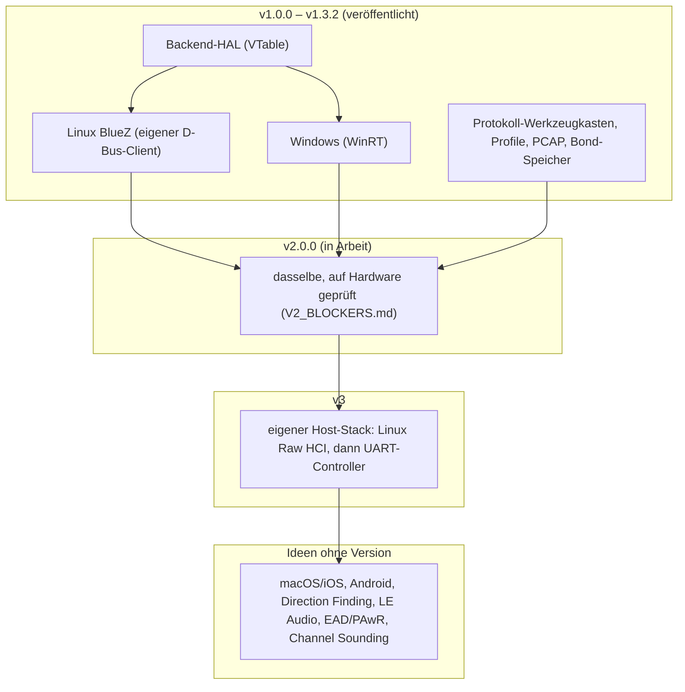

# Zig-BLE: Roadmap und Release-Matrix

> **Aktueller Release:** v2.0.0-rc.1 (Release Candidate, 2026-11-22)
> **Nächstes Release:** v2.0.0, die vorhandenen Funktionen, auf Windows und Linux auf echter Hardware geprüft. Keine neuen Funktionen. Was dafür fehlt, steht in [V2_BLOCKERS.md](V2_BLOCKERS.md).
> **Danach:** v3 mit eigenem Host-Stack (Abschnitt 4), dann Ideen ohne Versionsnummer (Abschnitt 5).
> **Compiler:** Zig 0.17.0+

Stand: 2026-11-21. Diese Seite beschreibt, was es gibt und was kommen soll. Was eine Version
im Einzelnen geändert hat, steht im [CHANGELOG](../CHANGELOG.md); was auf Hardware geprüft ist,
in [HARDWARE_TESTS.md](HARDWARE_TESTS.md).

## Inhalt

1. [Release-Philosophie](#1-release-philosophie)
2. [Rückblick: v1.0.0 bis v1.3.2](#2-rückblick-v100-bis-v132)
3. [Was es heute gibt](#3-was-es-heute-gibt)
4. [v3: eigener Host-Stack](#4-v3-eigener-host-stack)
5. [Ideen ohne Version](#5-ideen-ohne-version)
6. [Release-Matrix](#6-release-matrix)

---

## 1. Release-Philosophie

Eine Funktion zählt erst, wenn sie auf echter Hardware gelaufen ist. Eine Idee bekommt erst eine
Versionsnummer, wenn sie gebaut ist und sich auf Hardware testen lässt
([PHILOSOPHY.md](PHILOSOPHY.md)).

- **v1.0.0 bis v1.3.2 (veröffentlicht):** HAL mit Windows- und BlueZ-Backend,
  Protokoll-Werkzeugkasten (Parser, Krypto, Profile, PCAP), Bond-Speicher, Mock-Backend. Geprüft
  mit Mock und CI, nicht systematisch auf Hardware. v1.3.0 bis v1.3.2 konnten unter Windows weder
  scannen noch GATT nutzen; das BlueZ-Backend von v1.3.0 kompilierte nicht für Linux.
- **v2.0.0 (in Arbeit):** dieselben Funktionen, auf Windows und Linux auf echter Hardware geprüft,
  jeder Test 10 von 10 an zwei Tagen. Was nur manchmal funktioniert, gilt als nicht erledigt.
  macOS ist ausgenommen; Raw HCI, UART und EATT bleiben experimentell (Entscheidungen E1–E3 in
  [V2_BLOCKERS.md](V2_BLOCKERS.md)).
- **v3:** ein eigener Host-Stack für Systeme ohne BlueZ oder WinRT (Abschnitt 4).
- **Ohne Version:** Ideen aus Abschnitt 5.

---

## 2. Rückblick: v1.0.0 bis v1.3.2

Kurzfassung je Version. Die Release Notes jener Zeit versprechen mehr, als auf Hardware belegt
ist; maßgeblich ist der Stand in Abschnitt 3.

| Version | Datum | Inhalt |
| :--- | :--- | :--- |
| v1.0.0 | 2026-10-06 | `BackendVTable` und `UnifiedAdapter`, BlueZ über den eigenen D-Bus-Client, erstes Windows-Backend über Win32, ATT/GATT-Codec, Long Transfers (`src/core/transfers.zig`), H4-Framing und ACL-Reassembly, Bond-Speicher, Mock-Backend, PCAP-Writer. Ein Lauf unter Windows gegen ein Android-Smartphone las 30 von 31 Characteristics. |
| v1.0.1 | 2026-10-07 | CI-Fixes für macOS (Aufrufkonvention der Windows-Bindings), Zeitstempel, BlueZ-Properties. |
| v1.1.0 | 2026-10-07 | `exchangeMtu`, `pair`/`unpair`/`BondState` in der HAL, BlueZ `AcquireNotify`, L2CAP-CoC-API (`L2capStream`), PCAP- und btsnoop-Reader, EATT-Bausteine (`src/core/eatt.zig`), Connection Subrating als HCI-Befehle (`src/hci/subrating.zig`). Geprüft gegen das Mock-Backend. |
| v1.1.1 | 2026-10-09 | Umstellung auf Zig 0.17.0. |
| v1.1.2 | 2026-10-15 | Windows-Backend über WinRT-COM in reinem Zig (`RoInitialize`, `BluetoothLEAdvertisementWatcher`, `FromBluetoothAddressAsync`, `GattValueChangedHandler`), BlueZ-Backend vervollständigt. |
| v1.2.0 | 2026-10-27 | Profile Pulse Oximeter, Fitness Machine, Cycling Power, Running Speed & Cadence. |
| v1.3.0 | 2026-10-28 | Punkte aus [PRODUCTION_READINESS.md](PRODUCTION_READINESS.md): Krypto gegen die Testvektoren der Spezifikation, verschlüsselter und per AES-CMAC geschützter Bond-Speicher, Härtung des Pairing-Agents, Fehler statt `catch {}`, echte MTU, Windows-Pairing und -Peripheral, Timeouts, konkrete Fehlermengen. |
| v1.3.1 | 2026-10-29 | BlueZ-Backend kompiliert wieder für Linux, CSPRNG unter macOS, Bond-Speicher unter Zig 0.17. |
| v1.3.2 | 2026-10-29 | Große Module in Untermodule aufgeteilt, keine Datei über 1000 Zeilen. |

Nach v1.3.2 zeigte der Vergleich mit anderen Bibliotheken ([COMPARISON.md](COMPARISON.md)) und die
ersten Hardware-Läufe, dass Windows weder scannen noch GATT nutzen konnte und BlueZ keine Signale
las. Beides ist behoben; die Fehler und ihre Belege stehen in [V2_BLOCKERS.md](V2_BLOCKERS.md).

---

## 3. Was es heute gibt

Spalte **Stand**: *Hardware* = auf echter Hardware geprüft (Belege in
[HARDWARE_TESTS.md](HARDWARE_TESTS.md)), *Tests* = nur Unit-, Mock- oder Fuzz-Tests,
*experimentell* = nie gegen einen echten Controller gelaufen.

| Bereich | Wo | Stand |
| :--- | :--- | :--- |
| Windows-Backend: Scan, Verbinden, GATT, Notifications, Indications, Pairing (alle vier Methoden), Peripheral-Rolle | [`src/backend/windows/`](../src/backend/windows/), [`src/gatt_server/`](../src/gatt_server/) | Hardware |
| BlueZ-Backend: Scan, Verbinden, GATT, Notifications, Indications, Pairing über den Agent, Peripheral-Rolle | [`src/backend/bluez/`](../src/backend/bluez/), [`src/agent.zig`](../src/agent.zig) | Hardware (Reconnect nach dem Koppeln als Central: bekannte Einschränkung des Kernels, B13) |
| `UnifiedAdapter`, Auto-Resubscribe, `ConnectionState` | [`src/backend/unified.zig`](../src/backend/unified.zig) | Hardware |
| D-Bus-Client ohne `libdbus` | [`src/dbus/`](../src/dbus/) | Hardware (über BlueZ) |
| Mock-Backend | [`src/backend/mock/`](../src/backend/mock/) | Tests |
| ATT/GATT-Codec, Long Transfers | [`src/core/`](../src/core/) | Tests; auf Hardware Werte bis 512 Byte bei MTU 517, also noch ohne Read Blob und Prepare Write (B9) |
| Krypto (AES-CMAC, `f4`–`h7`, `ah`, `c1`, `s1`), SMP-Codec und -Zustandsmaschine | [`src/crypto/`](../src/crypto/) | Tests gegen die Testvektoren der Spezifikation |
| Bond-Speicher (AES-128-CTR, AES-CMAC, DPAPI, Dateirechte 0600) | [`src/storage/bond_store.zig`](../src/storage/bond_store.zig) | Tests |
| SIG-Profile (12) plus iBeacon, Eddystone, Nordic UART | [`src/profiles/`](../src/profiles/) | Tests |
| PCAP-Writer, PCAP- und btsnoop-Reader | [`src/tooling/pcap.zig`](../src/tooling/pcap.zig) | Tests |
| Raw HCI und UART (`HciBackend`, `UartBackend`), H4/H5, ACL, L2CAP-Signaling | [`src/backend/hci.zig`](../src/backend/hci.zig), [`src/backend/uart.zig`](../src/backend/uart.zig), [`src/hci/`](../src/hci/), [`src/l2cap/`](../src/l2cap/) | experimentell |
| EATT-Bearer und -Multiplexer | [`src/core/eatt.zig`](../src/core/eatt.zig) | experimentell, an kein Backend angebunden |

Die gemessenen Zahlen der Parser stehen im README unter „Microbenchmarks“. Messungen über Funk
gibt es bisher nur als Nebenprodukt des Langzeittests (Zeit bis zur nutzbaren Verbindung,
[HARDWARE_TESTS.md](HARDWARE_TESTS.md)).

---

## 4. v3: eigener Host-Stack

Ziel: Zig-BLE läuft auch dort, wo es keinen Bluetooth-Stack des Betriebssystems gibt, oder wo man
ihn umgehen will. Die Controller-Firmware im Chip bleibt; Zig-BLE übernimmt, was heute BlueZ und
WinRT machen (L2CAP, ATT/GATT, SMP, GAP, Bonds). Auf dem Desktop bleiben BlueZ und WinRT der
Standard: ein eigener Stack nimmt den Adapter exklusiv in Beschlag.

Reihenfolge:

1. **Linux, Raw HCI (`HCI_CHANNEL_USER`)** mit dem vorhandenen USB-Adapter, getestet gegen das
   Windows-Peripheral: erst Scannen, dann Verbinden und GATT, zuletzt SMP. Der Kernel lädt die
   Firmware des Adapters.
2. **Externer Controller über UART** (z. B. nRF52840 mit Zephyr `hci_uart`): derselbe Code unter
   Windows, Linux und macOS, und der Weg zum Mikrocontroller.
3. Eigene USB-Anbindung unter Windows (WinUSB) nur, wenn es einen Grund gibt: die Firmware müsste
   Zig-BLE dann selbst laden, je nach Chip anders.

Was dafür fehlt (siehe [PRODUCTION_READINESS.md](PRODUCTION_READINESS.md), 15–21):

- SMP im Backend: die Zustandsmaschine kann Numeric Comparison, Passkey Entry und die
  Schlüsselverteilung; `HciBackend` paart bisher nur als Initiator. Es fehlen die Responder-Rolle,
  der Security Request und das Auflösen privater Adressen mit gespeicherten IRKs.
- ACL-Flusskontrolle mit Credits.
- GAP: Advertising, Verbindungsparameter, mehrere Verbindungen, Peripheral-Rolle.
- Eigenheiten der Controller.
- Hardware-Tests für alles, mit derselben Infrastruktur wie für v2.

---

## 5. Ideen ohne Version

Keines der hier genannten Module existiert. Eine Idee bekommt erst eine Version, wenn sie gebaut
ist und sich auf Hardware testen lässt.

- **macOS und iOS:** ein Backend über `CoreBluetooth` und die Objective-C-Runtime
  (`objc_msgSend`), ohne Swift- oder C++-Schicht. Für v2 ausgeschlossen (E3), weil es keinen Mac
  zum Testen gibt. Über einen UART-Controller (Abschnitt 4) läuft Zig-BLE dort auch ohne
  CoreBluetooth.
- **Android:** Zig-Decoder hinter JNI, mit Puffern über `GetDirectBufferAddress` statt Kopien,
  oder der Dateideskriptor eines L2CAP-Kanals aus `createL2capChannel()`.
- **Direction Finding (BT 5.1, AoA/AoD):** I/Q-Abtastwerte der Constant Tone Extension aus dem
  Controller lesen und daraus Winkel schätzen. Braucht Controller mit Antennen-Array und den
  eigenen Stack.
- **LE Audio und Auracast (BT 5.2):** isochrone Kanäle (CIS, BIS), LC3-Codec, Profile BAP, CAP,
  PACS. Braucht den eigenen Stack; BlueZ und WinRT bieten das Anwendungen nur eingeschränkt an.
- **Encrypted Advertising Data und PAwR (BT 5.4):** verschlüsselte Advertising-Daten (AD-Typ
  `0x31`, AES-CCM); Periodic Advertising with Responses, z. B. für elektronische Preisschilder
  (ESL, Service `0x1857`).
- **Channel Sounding (BT 6.0):** Entfernungsmessung über Phasendifferenz (PBR) und Laufzeit (RTT),
  mit Schutz gegen Relay-Angriffe. Braucht Controller mit CS-Unterstützung und den eigenen Stack.

---

## 6. Release-Matrix

| Version | Inhalt | Status |
| :--- | :--- | :--- |
| v1.0.0 – v1.3.2 | siehe Abschnitt 2 | veröffentlicht (Windows-Scan und -GATT in v1.3.0–v1.3.2 defekt, siehe CHANGELOG) |
| v2.0.0-rc.1 | Release Candidate: die vorhandenen Funktionen auf Hardware geprüft, bis auf die offenen Punkte in V2_BLOCKERS | veröffentlicht 2026-11-22 |
| v2.0.0 | die vorhandenen Funktionen, auf Windows und Linux auf echter Hardware geprüft | in Arbeit ([V2_BLOCKERS.md](V2_BLOCKERS.md)) |
| v3 | eigener Host-Stack: Linux Raw HCI, dann UART-Controller | geplant |
| ohne Version | Ideen aus Abschnitt 5 | Idee |
