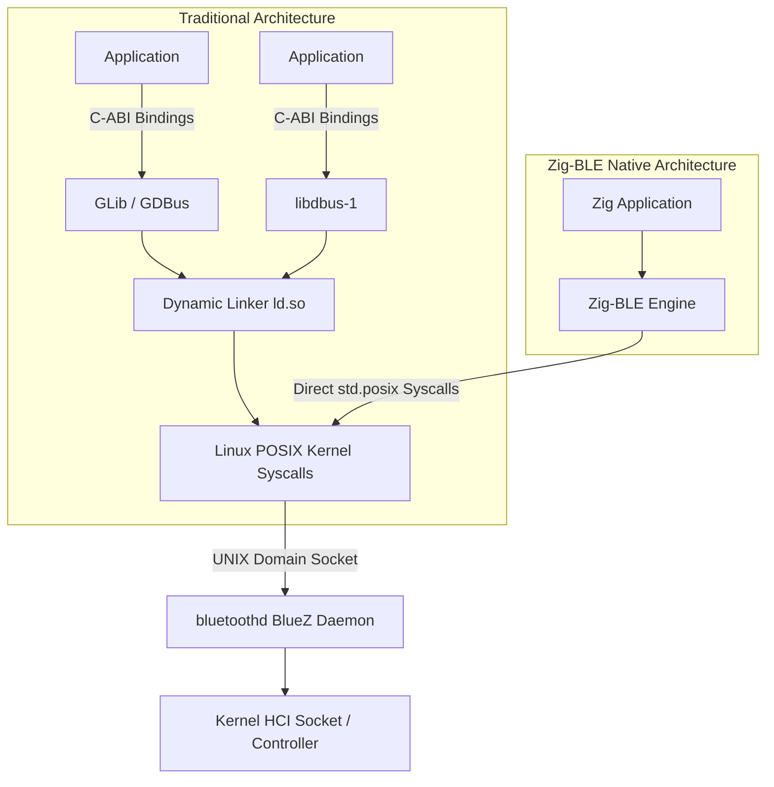
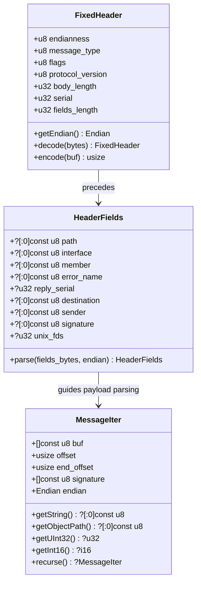
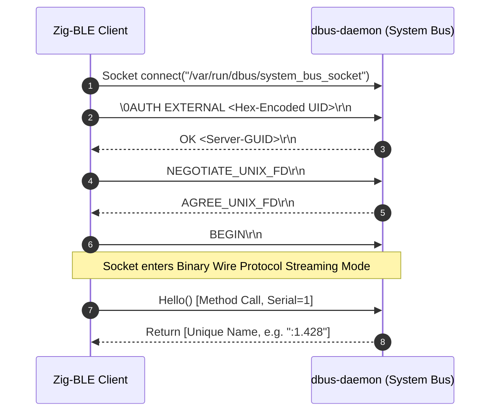
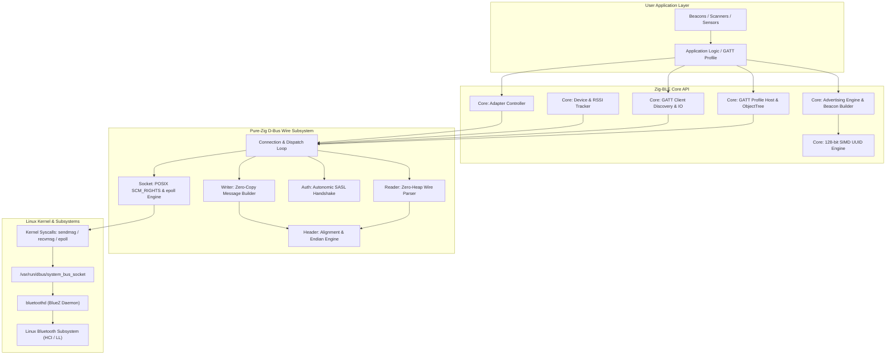
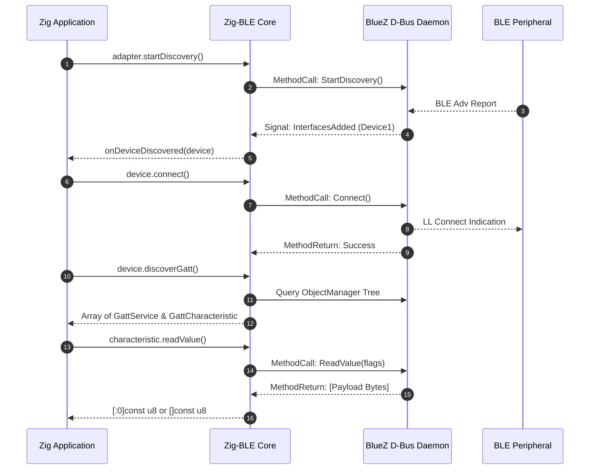

# Zig-BLE: A Pure-Zig Bluetooth Low Energy Library for Linux and Windows

**Technical White Paper | Version 3.0**  
**Author:** Attila Faust & The Zig-BLE Core Contributors  
**Target Release:** Zig-BLE v1.2.0 (Zig 0.17.0+)  
**Repository:** [github.com/AritoUser/Zig-BLE](https://github.com/AritoUser/Zig-BLE)  

---

## Abstract

On Linux, applications talk to the Bluetooth daemon BlueZ over D-Bus. Most libraries do this through C libraries such as `libdbus-1` or GLib/GDBus. These dependencies complicate cross-compilation (target sysroots, glibc version mismatches) and make it harder to ship small, self-contained binaries for embedded Linux and edge gateways.

This paper describes Zig-BLE, a Bluetooth Low Energy library written entirely in Zig. On Linux it implements the freedesktop.org D-Bus wire protocol itself, directly on top of POSIX system calls (UNIX domain sockets, `SCM_RIGHTS`, `poll`/`epoll`), and talks to BlueZ without any C library. On Windows it uses the WinRT Bluetooth APIs. Connections, encryption and pairing are still performed by BlueZ or Windows; Zig-BLE replaces the C client libraries, not the operating system's Bluetooth stack.

The paper presents the D-Bus wire implementation (alignment, bi-endian decoding, sentinel-safe string slicing, SASL authentication, file descriptor passing), the BLE components built on it, and microbenchmarks of the protocol parsers. The parsers decode without copying and without heap allocation; a complete advertising packet is parsed in about 5.5 ns. Statically linked, stripped example binaries for `aarch64-linux-musl` are 140–240 KB.

---

## Table of Contents

1. [Introduction & Motivation](#1-introduction--motivation)
   - 1.1 The Linux Bluetooth Ecosystem & The Cost of C-ABIs
   - 1.2 The Cross-Compilation Sysroot Burden
   - 1.3 Architectural Inefficiencies of Traditional D-Bus Implementations
   - 1.4 The Zig-BLE Architectural Philosophy
2. [Pure-Zig D-Bus Wire Protocol Architecture](#2-pure-zig-d-bus-wire-protocol-architecture)
   - 2.1 Specification Compliance & Zero-Heap Wire Layout
   - 2.2 Strict Alignment & Deterministic Padding Computation
   - 2.3 Bi-Endian Dynamic Decoding (`.little` & `.big`)
   - 2.4 Safe Sentinel String Slicing (`[:0]const u8`)
   - 2.5 Autonomous SASL EXTERNAL Handshake & Credentials Hexing
   - 2.6 UNIX File Descriptor Transfer via `SCM_RIGHTS`
3. [System Architecture & Component Design](#3-system-architecture--component-design)
   - 3.1 Layered System Architecture
   - 3.2 BlueZ 5.x Object Model Mapping
   - 3.3 Event Loop & Asynchronous I/O Multiplexing (`epoll` / `poll`)
   - 3.4 128-bit SIMD UUID Representation & Fast Parsing
   - 3.5 Zero-Copy BLE Advertising Engine
4. [GATT Client & Server Mechanics](#4-gatt-client--server-mechanics)
   - 4.1 GATT Client Pipeline & Service Discovery
   - 4.2 GATT Server Hosting & Dynamic Object Tree Export
   - 4.3 High-Bandwidth MTU Pipe Streaming via File Descriptors
   - 4.4 Pre-Built GATT Standard Profiles (HRP, BAS, ESS, NUS)
   - 4.5 Proximity & Broadcast Frames: Apple iBeacon & Google Eddystone
   - 4.6 Bluetooth 5.0+ Extended Advertising & LE Coded PHY (Long Range)
   - 4.7 Direct Linux Kernel L2CAP Connection-Oriented Channels (CoC)
5. [Microbenchmarks & Performance Evaluation](#5-microbenchmarks--performance-evaluation)
   - 5.1 Benchmark Methodology & Test Environment
   - 5.2 Microbenchmark Results
   - 5.3 Binary Size & What Was Not Measured
   - 5.4 Heap Usage
6. [Testing, Fuzzing & Safety Properties](#6-testing-fuzzing--safety-properties)
   - 6.1 Spatial and Temporal Safety Properties in Zig
   - 6.2 Boundary Validation
   - 6.3 Fuzz Testing (Wire & Advertising Engines)
   - 6.4 Continuous Integration Matrix
7. [Industrial IoT & Embedded Linux Deployment](#7-industrial-iot--embedded-linux-deployment)
   - 7.1 Cross-Compilation Without Sysroots (`aarch64-linux-musl`)
   - 7.2 Minimal Footprint Environments (Alpine Linux, Proxmox LXC, Docker Scratch)
   - 7.3 Edge Gateways & Medical Telemetry
8. [Conclusion & Future Roadmap](#8-conclusion--future-roadmap)
   - 8.1 Summary
   - 8.2 Future Roadmap
9. [References](#9-references)

---

## 1. Introduction & Motivation

### 1.1 The Linux Bluetooth Ecosystem & The Cost of C-ABIs

Bluetooth Low Energy (BLE) has become the de facto protocol for short-range low-power telemetry, medical sensors, industrial automation, and consumer peripherals. On Linux-based operating systems, the Linux kernel provides the Bluetooth core subsystems (`bluetooth.ko`, `hci_uart`, `btusb`), while user-space hardware orchestration, bonding, pairing, and profile hosting are managed centrally by **BlueZ**—the official Linux Bluetooth daemon.



Historically, software targeting BlueZ has had to communicate across the system D-Bus IPC (`/var/run/dbus/system_bus_socket`). Accessing this bus from application code required linking against C libraries:
* **`libdbus-1`**: The reference implementation, written in C99 with deep legacy conventions.
* **`GDBus` / GLib**: The GNOME object system abstraction, requiring the entire GLib runtime dependency graph.

While acceptable for desktop environments, this architecture is counter-productive in embedded systems, real-time edge devices, and resource-constrained environments.

### 1.2 The Cross-Compilation Sysroot Burden

In modern embedded engineering (e.g., targeting ARM Cortex-A, RISC-V, or MIPS platforms via Yocto, Buildroot, or customized distributions), cross-compilation is standard practice. Linking against `libdbus-1` introduces a complex "triad problem":
1. **Target Sysroot Matching**: Developers must maintain a target root filesystem containing matching header files (`dbus/dbus.h`, `dbus/dbus-arch-deps.h`) and precompiled shared objects (`libdbus-1.so`).
2. **Libc Incompatibilities**: Subtle glibc version mismatches between the build host sysroot and the target runtime cause dynamic linking failures (`GLIBC_X.XX not found`).
3. **Toolchain Friction**: Multi-stage builds fail when building lightweight containers (e.g., Alpine Linux with Musl libc) because `libdbus-1` packages pull in cascading dynamic libraries.

Zig's core design philosophy revolutionizes this paradigm: `zig build` contains its own integrated cross-compiler, C compiler, and libc implementations for all major targets out of the box. However, linking against external C libraries destroys this advantage. By replacing external C libraries with pure Zig code, **cross-compilation becomes an instantaneous one-line operation without any sysroot requirement**:
```bash
zig build -Dtarget=aarch64-linux-musl
```

### 1.3 Architectural Inefficiencies of Traditional D-Bus Implementations

Beyond build-time friction, general-purpose D-Bus libraries make design choices that suit desktops but are less convenient for small, long-running services:
* **Locking**: `libdbus-1` is thread-safe by design and protects connections with internal locks, even when an application uses a single thread.
* **Heap allocation**: Building or decoding a message (for example a variant map `a{sv}`) creates many separate heap objects for messages, signatures and values.
* **Copying**: Decoded strings, object paths and byte arrays are typically copied into new buffers instead of being referenced in the receive buffer.
* **Dependencies**: Applications must ship or depend on the shared libraries (and, for GDBus, the GLib runtime) on every target.

These costs are small in absolute terms for most applications. The main motivation for Zig-BLE is therefore not raw speed but dependency-free builds, simple deployment and predictable resource use.

### 1.4 The Zig-BLE Architectural Philosophy

Zig-BLE was designed from first principles to resolve these architectural bottlenecks. Its fundamental engineering invariants are:
1. **No External Dependencies**: Pure Zig. No C headers, no C library links, no external packages. (On Windows, the WinRT system APIs are called directly; `-Dlink-dbus` optionally links the system `libdbus-1` on Linux.)
2. **No Heap Allocation When Decoding**: Message reading, signature parsing, alignment calculation and advertisement parsing work on stack buffers or caller-supplied slices. Building outgoing D-Bus messages uses a growable buffer from a caller-supplied allocator.
3. **Direct Kernel Syscall Interfacing**: Direct invocation of Linux kernel facilities (`std.posix.socket`, `std.posix.sendmsg`, `std.posix.recvmsg`, `std.posix.epoll`) bypassing C runtime wrappers.
4. **Compile-Time Verification**: Leveraging Zig's `comptime` engine for type safety, signature derivation, and structural validation at compile time.

---

## 2. Pure-Zig D-Bus Wire Protocol Architecture

The freedesktop.org D-Bus Wire Protocol is a binary IPC protocol designed for high-performance message exchange between processes on the same host or across networks. Implementing this protocol natively in Zig requires exact mathematical modeling of message frames, header alignment, signature parsing, and credential handshaking.



### 2.1 Specification Compliance & Zero-Heap Wire Layout

A D-Bus wire message consists of four sequential blocks:
1. **Fixed Header (16 bytes)**: Endianness flag (`'l'` or `'B'`), message type (1=Method Call, 2=Method Return, 3=Error, 4=Signal), flags (e.g., `NO_REPLY_EXPECTED`), protocol version (must be 1), 32-bit body length, 32-bit message serial, and 32-bit header fields array length.
2. **Header Fields Array (`a(yv)`)**: An array of structure pairs comprising an 8-bit field code and a variant containing the field value (e.g., Object Path, Interface, Member, Destination, Signature, Unix FDs count).
3. **Header Padding (0 to 7 bytes)**: Padding bytes (`\0`) inserted to align the Message Body to an **8-byte boundary** relative to the beginning of the message.
4. **Message Body**: Variable-length payload marshaled according to the signature declared in Header Field 8.

Zig-BLE implements this layout in [`src/dbus/wire/header.zig`](../src/dbus/wire/header.zig) and [`src/dbus/wire/message.zig`](../src/dbus/wire/message.zig). Deserialization is entirely zero-heap: the incoming byte buffer received from the socket is sliced in-place without copying.

### 2.2 Strict Alignment & Deterministic Padding Computation

The D-Bus specification mandates that every data type must start at an offset divisible by its natural size:
* `u16`, `i16`: 2-byte alignment.
* `u32`, `i32`, `f32`, `boolean`, `string`, `object_path`: 4-byte alignment.
* `u64`, `i64`, `f64`, `struct`, `dict_entry`: 8-byte alignment.

Zig-BLE implements deterministic, branch-free alignment calculation in [`src/dbus/wire/types.zig`](../src/dbus/wire/types.zig):

$$\text{paddingRequired}(\text{offset}, \text{align}) = (\text{align} - (\text{offset} \pmod{\text{align}})) \pmod{\text{align}}$$

$$\text{alignOffset}(\text{offset}, \text{align}) = \text{offset} + \text{paddingRequired}(\text{offset}, \text{align})$$

```zig
pub inline fn paddingRequired(offset: usize, alignment: usize) usize {
    const rem = offset % alignment;
    return if (rem == 0) 0 else alignment - rem;
}

pub inline fn alignOffset(offset: usize, alignment: usize) usize {
    return offset + paddingRequired(offset, alignment);
}
```

This guarantees that all multi-byte integers, pointers, and structures are accessed strictly on compliant memory boundaries, preventing unaligned memory trap faults on architectures with strict alignment requirements (e.g., older ARM or MIPS CPUs).

### 2.3 Bi-Endian Dynamic Decoding (`.little` & `.big`)

While the majority of modern Linux hosts operate in Little-Endian mode (`'l'`, ASCII `0x6C`), the D-Bus specification explicitly permits a peer or broker to send messages in Big-Endian mode (`'B'`, ASCII `0x42`). A robust protocol stack cannot assume host endianness for wire reading.

Zig-BLE implements dynamic bi-endian decoding. The [`FixedHeader`](../src/dbus/wire/header.zig) extracts the wire endianness, which is propagated down to the [`MessageIter`](../src/dbus/wire/reader.zig):

```zig
pub const FixedHeader = struct {
    endianness: u8,
    // ...
    pub fn getEndian(self: *const FixedHeader) std.builtin.Endian {
        return if (self.endianness == 'B') .big else .little;
    }
};
```

Within [`MessageIter`](../src/dbus/wire/reader.zig), every integer, float, and container length getter decodes data using `self.endian`:
```zig
pub fn getUInt32(self: *MessageIter) ?u32 {
    if (self.getArgType() != Type.uint32) return null;
    self.offset = types.alignOffset(self.offset, 4);
    if (self.offset + 4 > self.end_offset) return null;
    const val = std.mem.readInt(u32, self.buf[self.offset..][0..4], self.endian);
    self.offset += 4;
    if (!self.is_array) self.sig_idx += 1;
    return val;
}
```

This lets Zig-BLE decode messages from peers of either byte order, as the specification requires.

### 2.4 Safe Sentinel String Slicing (`[:0]const u8`)

In Zig, null-terminated strings are represented with sentinel-terminated slice types: `[:0]const u8`. This allows zero-cost interop with C APIs and runtime validation that accessing index `len` yields `0`.

Traditional parsers often resort to unchecked `@ptrCast` operations to coerce wire bytes into sentinel strings. Zig-BLE enforces strict bounds validation and sentinel safety:
```zig
pub fn getString(self: *MessageIter) ?[:0]const u8 {
    if (self.getArgType() != Type.string and self.getArgType() != Type.object_path) return null;
    self.offset = types.alignOffset(self.offset, 4);
    if (self.offset + 4 > self.end_offset) return null;
    const len = std.mem.readInt(u32, self.buf[self.offset..][0..4], self.endian);
    self.offset += 4;

    if (self.offset + len >= self.end_offset) return null;
    // Strictly verify wire null-terminator
    if (self.buf[self.offset + len] != 0) return null;
    
    // Construct verified sentinel-terminated slice directly from wire buffer
    const str = self.buf[self.offset .. self.offset + len :0];
    self.offset += len + 1;

    if (!self.is_array) self.sig_idx += 1;
    return str;
}
```
Every string returned by the reader therefore has its trailing `\0` byte inside the received buffer, so callers cannot read past the end of the packet through it.

### 2.5 Autonomous SASL EXTERNAL Handshake & Credentials Hexing

Before messages can be exchanged on the D-Bus UNIX socket, the client must perform a SASL authentication handshake. Under Linux, system services authenticate via `EXTERNAL` authentication, where the kernel transmits client process credentials (`ucred` struct via `SO_PEERCRED`).

Zig-BLE implements this handshake autonomously in [`src/dbus/wire/auth.zig`](../src/dbus/wire/auth.zig):
1. **Initial Null Byte (`\0`)**: Transmitted immediately upon connection to satisfy the UNIX domain socket credential passing requirement.
2. **UID Hex-Encoding**: The calling process retrieves its effective UID (`std.posix.system.getuid()`), formats it into a decimal ASCII string, and encodes each ASCII character as a two-digit hexadecimal representation.
   * *Example*: UID `1000` $\to$ ASCII `"1000"` $\to$ Hex `"31303030"`.
3. **AUTH EXTERNAL Command**:
   $$\texttt{"AUTH EXTERNAL 31303030\textbackslash r\textbackslash n"}$$
4. **UNIX FD Negotiation**: Zig-BLE issues `NEGOTIATE_UNIX_FD\r\n`. If the broker responds with `AGREE_UNIX_FD`, file descriptor passing is unlocked.
5. **BEGIN Command**: Zig-BLE sends `BEGIN\r\n`, transitioning the socket into raw binary message streaming mode.



### 2.6 UNIX File Descriptor Transfer via `SCM_RIGHTS`

Bluetooth Low Energy GATT operations require exchanging file descriptors when using high-throughput streaming channels (such as GATT Characteristic `AcquireWrite` / `AcquireNotify` or L2CAP CoC sockets). This prevents high-bandwidth data (e.g., 50 Hz ECG telemetry or audio) from traversing the D-Bus daemon's message broker.

Passing file descriptors over UNIX domain sockets requires POSIX auxiliary control messages (`cmsg`) with level `SOL_SOCKET` and type `SCM_RIGHTS`. Zig-BLE implements [`sendWithFds`](../src/dbus/wire/socket.zig) and [`recvWithFds`](../src/dbus/wire/socket.zig) directly over `std.posix.system.sendmsg` and `recvmsg`:

```zig
pub fn recvWithFds(self: Socket, buf: []u8, out_fds: []std.posix.fd_t) !RecvResult {
    var iov = [1]std.posix.iovec{.{ .base = buf.ptr, .len = buf.len }};
    var cmsg_buf: [std.posix.CMSG_SPACE(@sizeOf(std.posix.fd_t) * 8)]u8 align(@alignOf(std.posix.cmsghdr)) = undefined;

    var msg: std.posix.msghdr = .{
        .name = null,
        .namelen = 0,
        .iov = &iov,
        .iovlen = 1,
        .control = &cmsg_buf,
        .controllen = cmsg_buf.len,
        .flags = 0,
    };

    const n = try std.posix.recvmsg(self.fd, &msg, 0);
    // Parse cmsg chain and extract SCM_RIGHTS file descriptors
    // ...
}
```

The extracted descriptors are attached directly to the decoded [`Message`](../src/dbus/wire/message.zig) instance. When the application extracts a descriptor via `message.extractFd(index)`, ownership is safely transferred, preventing descriptor leaks.

---

## 3. System Architecture & Component Design

### 3.1 Layered System Architecture

Zig-BLE is organized in a modular, decoupled hierarchy designed to separate low-level byte serialization from high-level Bluetooth LE profile logic:



### 3.2 BlueZ 5.x Object Model Mapping

BlueZ manages Bluetooth state using the standard **D-Bus Object Manager specification** (`org.freedesktop.DBus.ObjectManager`). The object hierarchy maps physical hardware, discovered nodes, and hosted profiles:
* `/org/bluez`: Root path implementing `org.freedesktop.DBus.ObjectManager`.
* `/org/bluez/hci0`: Adapter interface (`org.bluez.Adapter1`).
* `/org/bluez/hci0/dev_XX_XX_XX_XX_XX_XX`: Remote device interface (`org.bluez.Device1`).
* `/org/bluez/hci0/dev_XX.../serviceXXXX`: Discovered GATT Service (`org.bluez.GattService1`).
* `/org/bluez/hci0/dev_XX.../serviceXXXX/charYYYY`: Discovered GATT Characteristic (`org.bluez.GattCharacteristic1`).

Zig-BLE interacts with this hierarchy by dispatching method calls (e.g., `StartDiscovery`, `Connect`, `WriteValue`, `ReadValue`) and capturing broadcast signals (`org.freedesktop.DBus.Properties.PropertiesChanged`, `InterfacesAdded`, `InterfacesRemoved`).

### 3.3 Event Loop & Asynchronous I/O Multiplexing (`epoll` / `poll`)

Blocking reads on the D-Bus socket would stall an application while it waits for Bluetooth events. The connection in [`src/dbus/wire/connection.zig`](../src/dbus/wire/connection.zig) therefore exposes a `poll`-based, non-blocking read step, and [`src/event_loop.zig`](../src/event_loop.zig) provides an `epoll`-based loop for applications that multiplex several file descriptors:
```zig
pub fn pollMessages(self: *Connection, timeout_ms: i32) !usize {
    var pfd = [1]std.posix.pollfd{.{
        .fd = self.socket.fd,
        .events = std.posix.POLL.IN,
        .revents = 0,
    }};

    const ret = try std.posix.poll(&pfd, timeout_ms);
    if (ret == 0) return 0; // Timeout

    if ((pfd[0].revents & std.posix.POLL.IN) != 0) {
        return self.readAvailableMessages();
    }
    return 0;
}
```
This enables seamless integration into event-driven runtime architectures, game loops, or asynchronous frameworks without spawning background OS threads.

### 3.4 128-bit SIMD UUID Representation & Fast Parsing

Bluetooth UUIDs can be represented in 16-bit (0x180D), 32-bit (0x0000180D), or standard 128-bit canonical hex string formats (`"0000180d-0000-1000-8000-00805f9b34fb"`). BlueZ reports UUIDs as strings, so they are parsed frequently.

Zig-BLE implements a vectorized, branchless UUID engine in [`src/core/types.zig`](../src/core/types.zig):
* **Binary Representation**: A 128-bit unsigned integer (`u128`) or `[16]u8` big-endian byte array.
* **Bluetooth Base UUID Math**: Standard 16-bit and 32-bit UUIDs are mapped into 128-bit space via compile-time constants:
  $$\text{UUID}_{128} = (\text{UUID}_{32} \ll 96) \lor \texttt{0x00000000\_0000\_1000\_8000\_00805F9B34FB}$$
* **SIMD Hex Conversion**: Hexadecimal nibbles are decoded with `@Vector` operations; a 36-character hyphenated UUID string is parsed in about **11 ns** (see Section 5).

### 3.5 Zero-Copy BLE Advertising Engine

The Bluetooth Core Specification (v5.4 / v6.0) defines the Structure of Advertising and Scan Response Data as a sequence of Length-Type-Value (LTV) elements within a 31-byte legacy PDU or extended advertising payload:

$$\text{PDU} = \sum_{i} \left[ \text{Length}_i (1\text{B}) \mathbin{\Vert} \text{AD\_Type}_i (1\text{B}) \mathbin{\Vert} \text{Payload}_i (\text{Length}_i - 1\text{B}) \right]$$

Zig-BLE's [`AdvertisingReport.parse`](../src/core/advertising.zig) parses raw advertising packets without dynamic memory allocation:
```zig
pub fn parse(raw_bytes: []const u8) AdvertisingReport {
    var report = AdvertisingReport{ .raw = raw_bytes };
    var offset: usize = 0;

    while (offset < raw_bytes.len) {
        const len = raw_bytes[offset];
        if (len == 0) break;
        if (offset + 1 + len > raw_bytes.len) break;

        const ad_type = raw_bytes[offset + 1];
        const data = raw_bytes[offset + 2 .. offset + 1 + len];

        switch (ad_type) {
            0x01 => report.flags = data[0],
            0x08, 0x09 => report.local_name = data,
            0x0A => report.tx_power_level = @as(i8, @bitCast(data[0])),
            0xFF => report.manufacturer_data = data,
            // ...
        }
        offset += 1 + len;
    }
    return report;
}
```
Strings (such as the Local Name) and byte slices (such as Manufacturer Specific Data or Service Data) point directly into the underlying buffer. Parsing a complete packet takes about **5.5 ns** (see Section 5).

---

## 4. GATT Client & Server Mechanics

### 4.1 GATT Client Pipeline & Service Discovery

When acting as a Central device (GATT Client), Zig-BLE provides a declarative, ergonomic API for service discovery and characteristic interactions:



### 4.2 GATT Server Hosting & Dynamic Object Tree Export

When acting as a Peripheral (GATT Server), an embedded device must export its own service tree to BlueZ via `org.bluez.GattManager1.RegisterApplication`. This requires exporting an implementation of `org.freedesktop.DBus.ObjectManager` containing:
1. `org.bluez.GattService1`: Primary service declarations with 128-bit UUIDs.
2. `org.bluez.GattCharacteristic1`: Characteristic definitions with flags (`read`, `write`, `notify`, `indicate`).
3. `org.bluez.GattDescriptor1`: Characteristic User Description and Client Characteristic Configuration (CCCD).

Zig-BLE allows developers to declare GATT profiles statically or dynamically in pure Zig. Incoming read and write method calls dispatched by BlueZ are matched against the local route table with zero string allocations, executing developer-defined callback functions and returning structured responses.

### 4.3 High-Bandwidth MTU Pipe Streaming via File Descriptors

For high-bandwidth peripherals (e.g., audio, raw sensors, firmware update via OTA), standard D-Bus method invocations for each packet introduce unacceptable latency. BlueZ supports the `AcquireWrite` and `AcquireNotify` methods on GATT characteristics.

Upon invoking `AcquireWrite`, BlueZ returns a connected UNIX stream socket file descriptor and the negotiated ATT MTU size:
```zig
const res = try characteristic.acquireWrite();
const pipe_fd = res.fd; // Native POSIX file descriptor
const mtu = res.mtu;     // e.g., 512 bytes

// Direct kernel streaming bypassing D-Bus
var writer = std.fs.File{ .handle = pipe_fd };
try writer.writeAll(firmware_chunk);
```
Zig-BLE extracts this descriptor directly from the D-Bus message control buffer (`SCM_RIGHTS`) without calling intermediate C wrapper functions. Data written to the socket goes to BlueZ without a D-Bus round trip per packet.

### 4.4 Pre-Built GATT Standard Profiles (HRP, BAS, ESS, NUS)

To eliminate boilerplate across telemetry applications, Zig-BLE incorporates dedicated, zero-allocation profile encoders and parsers conforming strictly to Bluetooth SIG profile specifications:

1. **Heart Rate Service (HRP v1.0, `0x180D`)**:
   - `HeartRateMeasurement`: Bit-packed flags (Bit 0: Heart Rate format 8/16-bit, Bits 1-2: Sensor Contact Status, Bit 3: Energy Expended Present, Bit 4: RR-Intervals Present).
   - Parsing and encoding operate entirely on byte slices with zero heap allocations, decoding 16-bit RR-interval arrays and cumulative joules.
2. **Battery Service (BAS v1.0, `0x180F`)**:
   - `BatteryService.parseLevel()` and `encodeLevel()`: Enforces strictly bounded 0–100% state-of-charge values with range verification.
3. **Environmental Sensing Service (ESS v1.0, `0x181A`)**:
   - `Temperature`: 16-bit signed integer with 0.01 °C resolution ($-273.15$ °C to $+327.67$ °C).
   - `Humidity`: 16-bit unsigned integer with 0.01 % resolution ($0.00$ % to $100.00$ %).
   - `Pressure`: 32-bit unsigned integer with 0.1 Pa resolution ($0.0$ Pa to $429496729.5$ Pa).
   - Provides zero-allocation conversion between raw wire fixed-point integers and standard floating-point representation (`f32` / `f64`).
4. **Nordic UART Service (NUS)**:
   - Full 128-bit vendor UUIDs: Primary Service `6E400001-B5A3-F393-E0A9-E50E24DCCA9E`, RX Characteristic `6E400002-...`, TX Characteristic `6E400003-...`.
   - `PacketChunker`: A zero-allocation slice iterator that automatically fragments arbitrarily large stream buffers across negotiated ATT MTU boundaries ($N \le \text{MTU} - 3$), essential for streaming serial shells and high-frequency sensor bursts without buffer truncation.

### 4.5 Proximity & Broadcast Frames: Apple iBeacon & Google Eddystone

Beyond connection-oriented GATT profiles, Zig-BLE incorporates native builders and decoders for industry-standard broadcast formats:

1. **Apple iBeacon (`src/profiles/beacon.zig`)**:
   - Standard 23-byte payload encoded into Manufacturer Specific Data (`0xFF`) under Apple's Company Identifier (`0x004C`).
   - Byte layout: Type `0x02`, Sub-length `0x15` (21 bytes), 16-byte Big-Endian Proximity UUID, 2-byte Big-Endian Major, 2-byte Big-Endian Minor, and 1-byte 2's complement Measured RSSI Power at 1 meter.
   - Zero-allocation validation via `AppleIBeacon.build()` and `AppleIBeacon.parse()`.
2. **Google Eddystone**:
   - Encoded under the standard 16-bit Service UUID `0xFEAA`.
   - **Eddystone-UID**: 10-byte Namespace ID, 6-byte Instance ID, and calibrated TX Power at 0 meters.
   - **Eddystone-URL**: Highly compressed URL encoding supporting RFC standard prefixes (`http://www.`, `https://www.`, `http://`, `https://`) and URI suffix expansion (`.com/`, `.org/`, `.edu/`, `.net/`, `.info/`, `.biz/`, `.io/`).
   - **Eddystone-TLM (Telemetry)**: Unencrypted telemetry frame carrying battery millivolts, beacon temperature (8.8 fixed-point °C), advertising PDU count, and time-since-boot in 100-millisecond counter ticks.

### 4.6 Bluetooth 5.0+ Extended Advertising & LE Coded PHY (Long Range)

Zig-BLE extends the advertising engine to support Bluetooth 5.0+ Extended Advertising and Secondary Advertising Channels via BlueZ's `LEAdvertisingManager1`:
* **Secondary Channel Configuration**: Supports `.one_m` (1 Msym/s uncoded), `.two_m` (2 Msym/s high-throughput), and `.coded` (LE Coded PHY S=2 or S=8 for long range).
* **Primary PHY Selection**: Allows specifying `.le_1m` or `.le_coded` for primary advertising packets on channels 37, 38, and 39.
* **Interval Parsing & Control**: Exposes millisecond interval controls (`min_interval_ms`, `max_interval_ms`) dynamically mapped to BlueZ `MinInterval` / `MaxInterval` dictionary properties.

### 4.7 Direct Linux Kernel L2CAP Connection-Oriented Channels (CoC)

While GATT is ideal for small, structured attribute access, high-throughput point-to-point streaming (e.g., telemetry logs, binary blobs, raw sensor arrays) suffers from ATT packet header overhead and D-Bus IPC latency.

Zig-BLE introduces `L2capSocket` in `src/l2cap/socket.zig`:
* **Kernel-Level Socket**: Opens a native Linux socket with domain `AF_BLUETOOTH` (`31`) and protocol `BTPROTO_L2CAP` (`0`).
* **Protocol Service Multiplexer (PSM)**: Binds or connects directly to dynamic LE PSM endpoints ($0x1001 \dots 0xFFFF$) using the POSIX `sockaddr_l2` structure with `bdaddr_type = BDADDR_LE_PUBLIC` or `BDADDR_LE_RANDOM`.
* **Zero-Allocation Streaming**: Provides direct POSIX `read()` and `write()` methods without intermediate buffers; flow control is handled by the kernel.

---

## 5. Microbenchmarks & Performance Evaluation

### 5.1 Benchmark Methodology & Test Environment

The microbenchmark suite lives in [`examples/benchmark.zig`](../examples/benchmark.zig) and runs with `zig build run-bench`.
* **Host**: AMD Ryzen 9 9950X3D, Windows 11.
* **Compiler**: Zig 0.17.0, `ReleaseFast`, single thread.
* **Timing**: `QueryPerformanceCounter` on Windows, `CLOCK_MONOTONIC` on Linux.
* **Method**: 1,000,000 to 10,000,000 iterations per target. Inputs are modified in every iteration and results are passed to `std.mem.doNotOptimizeAway`, so the compiler cannot compute the result once and reuse it. The suite was run three times; the table reports the median and the range.

### 5.2 Microbenchmark Results

| Benchmark Target | What is measured | Median (ns/op) | Range, 3 runs (ns/op) |
| :--- | :--- | ---: | ---: |
| **AdStructure ServiceData16** | 16-bit UUID + payload view extraction | 0.50 | 0.48 – 0.53 |
| **CCCD Encode/Decode** | Notify/indicate flag codec | 0.58 | 0.58 – 0.59 |
| **Address Parse & Classify** | 48-bit address string parse + classification | 0.75 | 0.71 – 0.80 |
| **Assigned Numbers Registry** | SIG service UUID → name lookup | 0.85 | 0.81 – 0.87 |
| **ACL Frame Reassembler** | Single-fragment L2CAP reassembly | 0.88 | 0.86 – 0.90 |
| **UUID Format to String** | 128-bit UUID → 36-char canonical string | 1.2 | 1.2 – 1.2 |
| **D-Bus MessageIter** | Wire payload argument iteration | 2.0 | 1.9 – 2.1 |
| **D-Bus Message.finalize** | Header serialization | 2.6 | 2.5 – 2.9 |
| **H4 UART Stream Parser** | H4 frame state machine | 5.1 | 5.1 – 6.0 |
| **AdvertisingReport Parse** | Complete packet: name, manufacturer data, appearance | 5.5 | 5.4 – 5.6 |
| **GATT Long Write** | Split 60 bytes into Prepare Writes + reassemble in server queue | 8.1 | 8.0 – 8.6 |
| **UUID Flat 32-char SIMD** | 32 hex chars → 128-bit UUID via `@Vector` | 11.0 | 11.0 – 11.2 |
| **UUID Canonical SIMD** | 36-char hyphenated string → 128-bit UUID | 11.4 | 11.3 – 11.5 |
| **BondStore Deserialize** | Binary NVS image parse + verification (`ZBGR`) | 11.9 | 11.8 – 13.0 |
| **AdIterator TLV Walk** | Walk all elements of an advertising packet | 19.7 | 19.6 – 21.1 |

**Interpretation:**
* Results below about 1 ns correspond to a few CPU cycles. They show that an operation is effectively free, but differences between them are dominated by measurement noise and compiler optimization and should not be compared.
* In a real BLE application the radio and the operating system set the pace: a connection interval is at least 7.5 ms, a D-Bus round trip to BlueZ takes tens of microseconds, and a busy scanner sees a few thousand advertising packets per second. At ~5.5 ns per packet, parsing uses far less than 0.01 % of one CPU core. The parser speed is therefore a guarantee of negligible overhead, not a source of higher over-the-air throughput.
* Results depend on CPU, operating system and power management. Run `zig build run-bench` several times on the target hardware for representative numbers.

### 5.3 Binary Size & What Was Not Measured

**Binary size (measured).** The examples built with `zig build -Dtarget=aarch64-linux-musl -Doptimize=ReleaseSmall` are statically linked and stripped:

| Executable | Size |
| :--- | ---: |
| `ble-scanner` | 173 KB |
| `ble-heart-rate` (peripheral) | 192 KB |
| `ble-raw-hci` | 143 KB |
| `Zig_BLE` (demo CLI) | 232 KB |

`x86_64-linux` builds are within a few percent of these sizes.

**Not measured.** No benchmarks of other libraries (`libdbus-1`, GDBus, `btleplug`, `SimpleBLE`, `bleak`) were run with the same inputs, and no end-to-end measurements (startup time, notifications per second, write-to-notify latency over a real link) exist yet. Earlier versions of this paper quoted figures for these comparisons; they were estimates and have been removed. A like-for-like end-to-end comparison on the same hardware and peer device is planned.

### 5.4 Heap Usage

* The decoding paths (`MessageIter`, header parsing, advertising parsing, ATT/SMP/HCI/H4 decoders, ACL reassembly) take no allocator and therefore cannot allocate on the heap. This is guaranteed by construction, not by measurement.
* Building outgoing D-Bus messages uses `ByteBuffer`, a growable buffer backed by a caller-supplied allocator. It can be pre-sized with `ByteBuffer.initCapacity`, or backed by a fixed buffer allocator to avoid the general-purpose heap.
* The Windows and BlueZ backends keep devices, characteristics and subscriptions in fixed-size pools.
* Stack usage is bounded: the header field marshaling buffer in `Message.finalize()` is a fixed 2,048-byte stack array.

---

## 6. Testing, Fuzzing & Safety Properties

### 6.1 Spatial and Temporal Safety Properties in Zig

Zig-BLE relies on Zig's language features to avoid common C memory errors:
* **Slice Bounds Checking**: Every access into wire buffers is bounds-checked at runtime in `Debug` and `ReleaseSafe` builds. In `ReleaseFast` and `ReleaseSmall` these checks are removed, so the parsers additionally validate lengths explicitly before every access.
* **Slices carry their length**: Pointer arithmetic is restricted, and buffers are passed as slices rather than raw pointers.
* **Explicit overflow behavior**: Wrapping arithmetic must be requested explicitly (`+%`, `*%`); ordinary integer overflow is detected in safe build modes.
* **Sentinel Semantics**: All `[:0]const u8` values returned by the D-Bus reader end at a null byte verified to lie inside the buffer.

### 6.2 Boundary Validation

When parsing untrusted packets, a malicious peer can try to trigger out-of-bounds reads with falsified length fields, for example:
* A 32-bit `body_length` of `0xFFFFFFFF`.
* Strings or arrays whose declared length exceeds the remaining buffer.
* Array byte sizes that do not match the element alignment.

[`src/dbus/wire/reader.zig`](../src/dbus/wire/reader.zig) checks `offset + len` against the end of the buffer before every read and returns `null` or an error instead of reading out of bounds. An explicit limit on container nesting depth (the D-Bus specification allows at most 32 levels) is not enforced yet.

### 6.3 Fuzz Testing (Wire & Advertising Engines)

Zig-BLE includes randomized fuzz harnesses for its two most exposed parsers:
* **D-Bus wire fuzzer (`zig build fuzz-dbus`)**: Random mutations of fixed headers, header field arrays, variants and signatures. Default: 200,000 iterations.
* **Advertising fuzzer (`zig build fuzz`)**: Random advertising packets with corrupted length fields, truncated strings and invalid AD types. Default: 500,000 iterations.

Both run without panics or out-of-bounds accesses. This is randomized testing, not formal verification; the ATT, SMP, HCI-event, H4 and L2CAP signaling parsers are covered by unit and edge-case tests but not yet fuzzed.

### 6.4 Continuous Integration Matrix

Every push and pull request runs on GitHub Actions with Zig 0.17.0:
* **Ubuntu Linux (x86_64)**: all unit and end-to-end tests, both fuzzers (50,000 iterations each), cross-compilation to `aarch64-linux`, the benchmark suite and documentation generation.
* **macOS (aarch64)** and **Windows (x86_64)**: unit tests of the core library.

---

## 7. Industrial IoT & Embedded Linux Deployment

### 7.1 Cross-Compilation Without Sysroots (`aarch64-linux-musl`)

Single-board computers such as the Raspberry Pi CM4, BeagleBone Black, Toradex Colibri or custom i.MX8 boards are common in industrial automation. With C libraries, targeting them requires a cross-toolchain (e.g. `aarch64-linux-gnu-gcc`) and a sysroot containing `libdbus-1-dev`.

With Zig-BLE, building a static, standalone binary for an ARM64 Linux device requires only:
```bash
zig build -Dtarget=aarch64-linux-musl -Doptimize=ReleaseSmall
```
The result is a statically linked executable of roughly 140–240 KB (see Section 5.3) that can be copied to the target with `scp` or placed in a read-only root filesystem.

### 7.2 Minimal Footprint Environments (Alpine Linux, Proxmox LXC, Docker Scratch)

* **Docker Scratch**: Because the binary is static, an application can run in a `FROM scratch` container that contains only the executable.
* **Alpine Linux / Proxmox LXC**: No `dbus-dev`, `glib-dev` or `build-essential` packages are needed. The container only needs access to the host's system bus socket (and BlueZ running on the host):
  ```bash
  # Proxmox / LXC configuration
  lxc.mount.entry = /var/run/dbus var/run/dbus none bind,create=dir 0 0
  ```

### 7.3 Edge Gateways & Medical Telemetry

Gateways for medical telemetry (glucose monitors, ECG patches, pulse oximeters) and industrial sensors often stay connected to many peripherals for long periods. Zig-BLE helps here in three ways:
1. **Bounded memory**: Decoding does not allocate, and the backends use fixed-size pools, so memory use does not grow with the number of packets processed. Long-duration soak tests have not been published yet.
2. **No garbage collector**: Unlike runtimes with garbage collection, there are no collection pauses in the notification path.
3. **BlueZ restart detection**: The BlueZ backend subscribes to `NameOwnerChanged` and `PropertiesChanged` signals to detect `bluetoothd` restarts and disconnected devices, so applications can react.

---

## 8. Conclusion & Future Roadmap

### 8.1 Summary

Zig-BLE shows that a BLE library for Linux and Windows can be written entirely in Zig, without C client libraries such as `libdbus-1` or GLib. As of v1.2.0 it provides:
* **Linux (BlueZ)**: a pure-Zig D-Bus wire client; scanning, connecting, GATT read/write/notifications, pairing via a BlueZ agent, GATT server and advertising; file-descriptor based streaming (`AcquireNotify`/`AcquireWrite`) and L2CAP CoC sockets.
* **Windows 11 (WinRT)**: scanning, connecting, service discovery and GATT read/write/notifications. Pairing and the peripheral role are not implemented yet.
* **A platform-independent protocol toolkit**: advertising, ATT/GATT, SMP, HCI, H4 and L2CAP encoders and decoders, the Bluetooth cryptographic functions, a bond store, SIG profiles (Heart Rate, Battery, Device Information, Current Time, Health Thermometer, Blood Pressure, HID, Environmental Sensing, Pulse Oximeter, Fitness Machine, Cycling Power, Running Speed & Cadence, Nordic UART, iBeacon, Eddystone) and a Wireshark PCAP writer.
* **Simple deployment**: static binaries of 140–240 KB, cross-compiled without sysroots.
* **Hardware validation**: verified over the air on Windows 11 against a Samsung Galaxy S25 Ultra (8 services, 38 characteristics, 30 of 31 reads successful).
* **Testing**: unit, end-to-end and edge-case tests, plus fuzzing of the D-Bus and advertising parsers.

### 8.2 Future Roadmap

The detailed list of open items is maintained in [PRODUCTION_READINESS.md](PRODUCTION_READINESS.md). The main milestones are:
1. **Production hardening**: correct negotiated-MTU reporting, error propagation instead of silently ignored failures, configurable timeouts, a documented threading model and concrete error sets in the public API.
2. **Windows feature parity**: pairing (`DeviceInformationCustomPairing`), the peripheral role (`GattServiceProvider`, `BluetoothLEAdvertisementPublisher`) and connection-loss handling.
3. **Bare-metal host stack**: HCI and UART backends, connection management, ATT client/server and SMP state machines over L2CAP, and wiring the existing EATT bearer bookkeeping to L2CAP credit-based channels.
4. **Measurement**: end-to-end benchmarks against other libraries on the same hardware, long-duration soak tests and hardware-in-the-loop CI.
5. **Later**: a macOS/iOS CoreBluetooth backend, LE Audio, Encrypted Advertising Data, PAwR and Channel Sounding.

---

## 9. References

1. **freedesktop.org**: *D-Bus Specification (Version 0.30+)*, [https://dbus.freedesktop.org/doc/dbus-specification.html](https://dbus.freedesktop.org/doc/dbus-specification.html).
2. **Bluetooth SIG**: *Bluetooth Core Specification Version 5.4 / 6.0*, [https://www.bluetooth.com/specifications/specs/](https://www.bluetooth.com/specifications/specs/).
3. **BlueZ Project**: *Linux Bluetooth Management & GATT API Documentation*, [https://git.kernel.org/pub/scm/bluetooth/bluez.git](https://git.kernel.org/pub/scm/bluetooth/bluez.git).
4. **The Zig Software Foundation**: *Zig Language Reference & Standard Library (0.17.0)*, [https://ziglang.org/documentation/](https://ziglang.org/documentation/).
5. **POSIX.1-2017 / Linux Foundation**: *UNIX Domain Sockets and SCM_RIGHTS Ancillary Data*, `unix(7)`, `cmsg(3)`, `sendmsg(2)`.
6. **Zig-BLE Project Repository**: *Native Pure-Zig BLE Stack*, [https://github.com/AritoUser/Zig-BLE](https://github.com/AritoUser/Zig-BLE).
